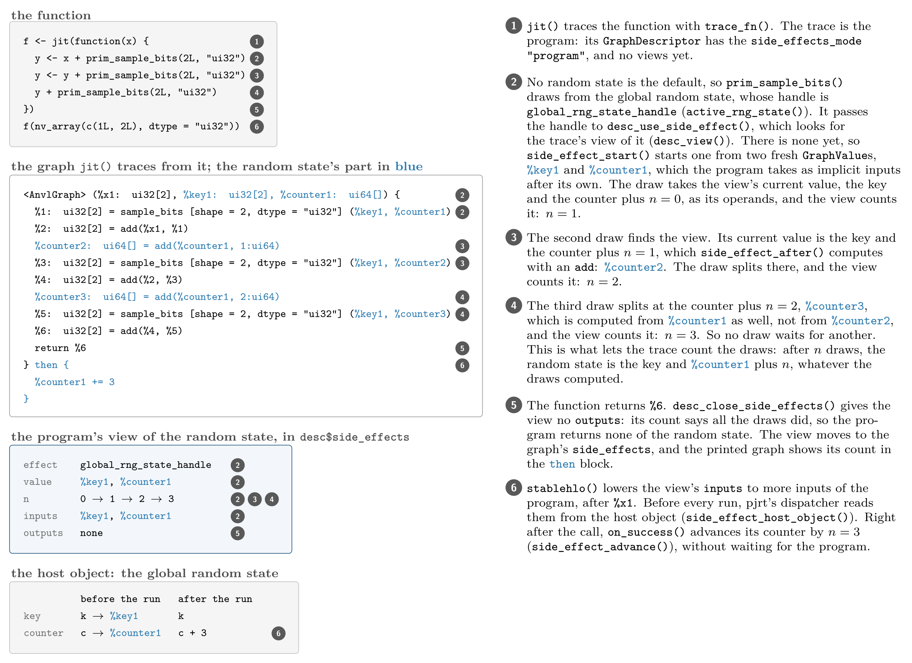
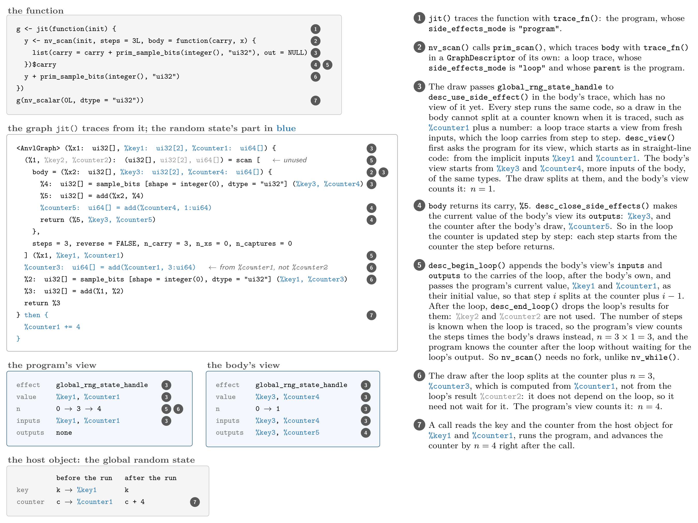
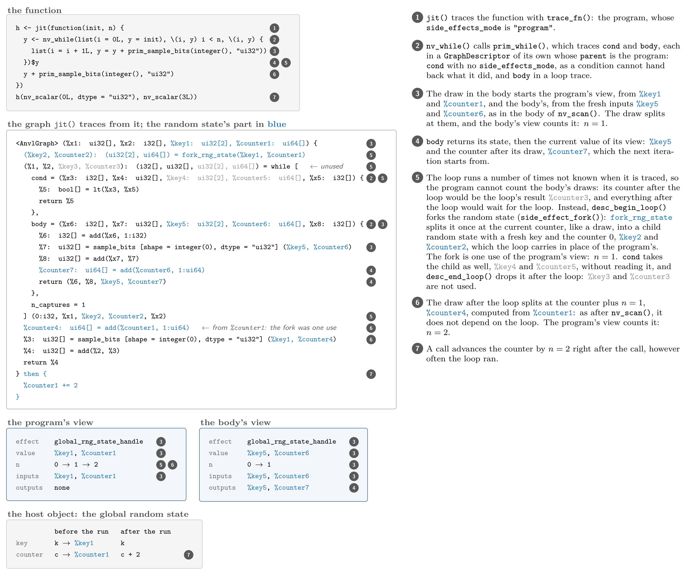
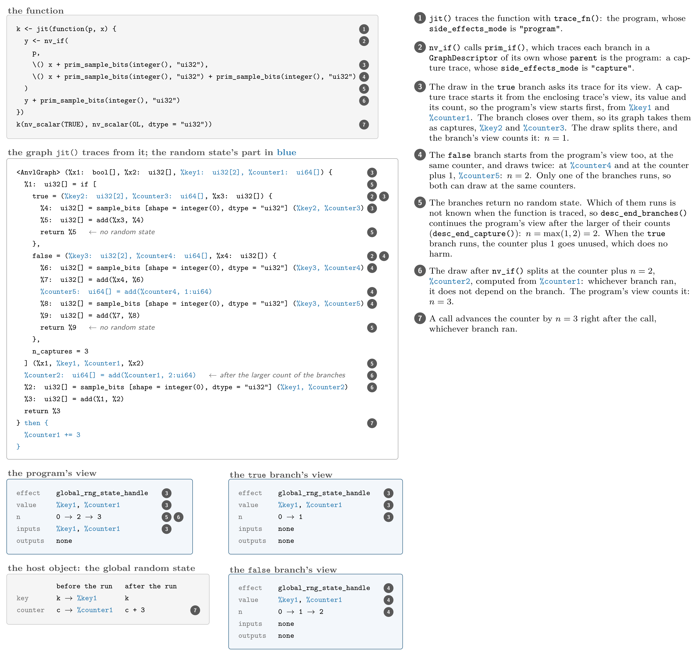
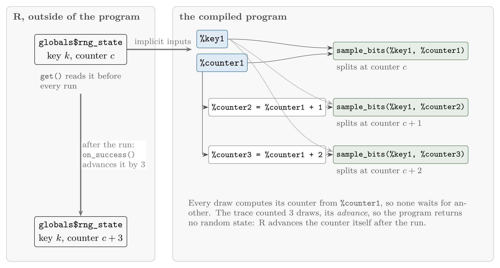
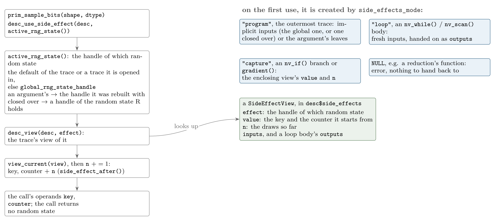
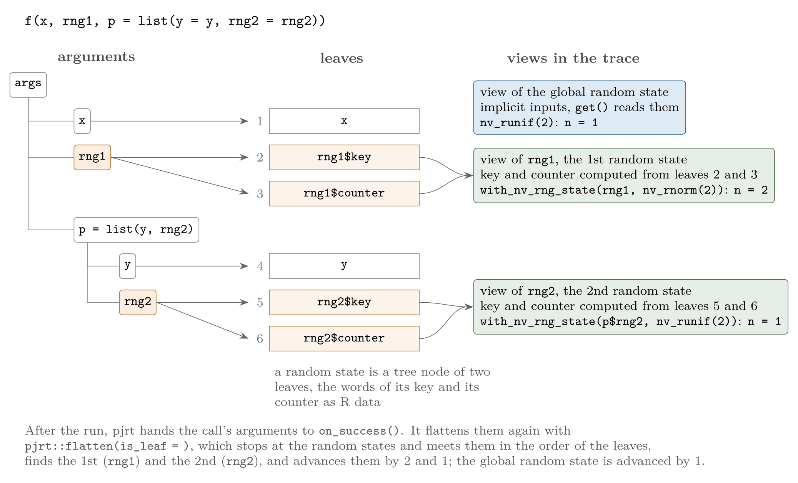
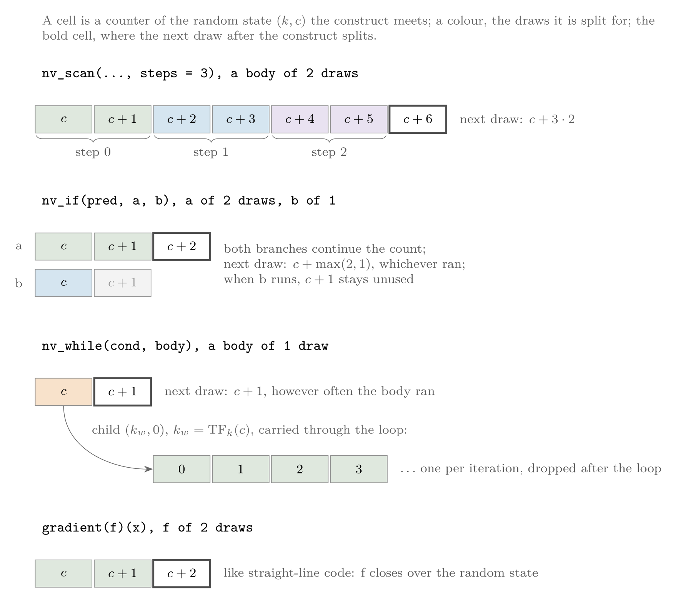

# Internals

## Transforming Code

While a real anvil is made for reshaping metal, this package is a tool
for reshaping code. We refer to such a rewriting of code as a
**transformation**, of which there are three types:

1.  `R` \\\rightarrow\\ `AnvlGraph`: Generic `R` functions are too
    complicated to handle, so the first step in {anvl} is always to
    convert them into a computational `AnvlGraph` object via
    **tracing**. Such an `AnvlGraph` is similar to `Jaxpr` objects in
    JAX. It operates only on `GraphNode`s – the graph’s stand-ins for
    arrays – and applies `AnvlPrimitiveDef` operations to them.
2.  `AnvlGraph` \\\rightarrow\\ `AnvlGraph`: It is possible to transform
    `AnvlGraph`s into other `AnvlGraph`s. Their purpose is to change the
    functionality of the code. At the time of writing, there is
    essentially only one such transformation, namely reverse-mode
    automatic differentiation via
    [`gradient()`](https://r-xla.github.io/anvl/reference/gradient.md).
3.  `AnvlGraph` \\\rightarrow\\ executable: In order to perform the
    actual computation, the `AnvlGraph` needs to be converted into an
    executable. The main backend is `"pjrt"` (via {stablehlo} and
    {pjrt}, compiling with XLA). There is also an experimental
    [quickr](https://github.com/t-kalinowski/quickr) backend.

### Tracing R Functions into Graphs

All functionality in the {anvl} package is centered around the
`AnvlGraph` class. While it is in principle possible to create
`AnvlGraph`s by hand, these are usually created by tracing R functions.
In general, when we want to convert some code into another form (in our
case, R code into an `AnvlGraph`), there are two approaches:

1.  Static analysis, which would require operating on the abstract
    syntax tree (AST) of the code.
2.  Dynamic analysis (aka “tracing”), which executes the code and
    records selected operations.

The former approach is followed by the {quickr} package, while we go
with tracing. We start with a simple yet illustrative example that
either adds or multiplies two inputs `x` and `y` depending on the value
of `op`.

``` r

library(anvl)
f <- function(x, y, op) {
  if (op == "add") {
    nv_add(x, y)
  } else if (op == "mul") {
    nv_mul(x, y)
  } else {
    stop("Unsupported operation")
  }
}
```

To do this, we use
[`trace_fn()`](https://r-xla.github.io/anvl/reference/trace_fn.md),
which takes in an `R` function and a list of `AbstractArray` inputs that
specify the input types.

``` r

aval <- nv_aval("f32", c())
aval
```

    ## AbstractArray(dtype=f32, shape=)

``` r

graph <- trace_fn(f, list(x = aval, y = aval, op = "mul"))
graph
```

    ## <AnvlGraph> (%x1: f32[], %x2: f32[]) {
    ##   %1: f32[] = mul(%x1, %x2)
    ##   return %1
    ## }

The output of
[`trace_fn()`](https://r-xla.github.io/anvl/reference/trace_fn.md) is
now an `AnvlGraph` object that represents the computation. The fields of
the `AnvlGraph` are:

- `inputs`, which are `GraphValue`s that represent the inputs to the
  function.
- `outputs`, which are `GraphValue`s that represent the outputs of the
  function.
- `statements`, which are `GraphStatement`s that take in `GraphNode`s
  (and parameters) and produce output `GraphValue`s.
- `constants`, which are the `GraphValue`s for values closed over by the
  traced function (see [constant handling](#constant-handling)).
- `in_tree`, `out_tree`, which record the nesting structure of the
  function’s inputs and outputs.

What happens during
[`trace_fn()`](https://r-xla.github.io/anvl/reference/trace_fn.md) is
that a new `GraphDescriptor` is created and the inputs `x` and `y` are
converted into `GraphBox` objects. Then, the function `f` is simply
evaluated with the `GraphBox` objects as inputs. During this evaluation,
we need to distinguish between two cases:

1.  A “standard” `R` function is called: Here, nothing special happens
    and the function is simply evaluated.
2.  An {anvl} function is called: Here, the operation that underlies the
    function is recorded in the `GraphDescriptor`.

The evaluation of the `if` statement is an example for the first
category. Because we set `op = "mul"`, only the second branch is
executed. Then, we are calling `nv_mul`, which attaches a
`GraphStatement` that represents the multiplication of the two arrays to
the `$statements` of the `GraphDescriptor`. Note that `nv_mul` is itself
not a primitive: it performs some type promotion and broadcasting if
needed before calling into the primitive `prim_mul`.

A `GraphStatement` object consists of the following fields:

- `primitive`: The primitive function that was called.
- `inputs`: The inputs to the primitive function.
- `params`: The parameters (non-arrays) to the primitive function.
- `outputs`: The outputs of the primitive function.

When the evaluation of `f` is complete, the `$outputs` field of the
`GraphDescriptor` is set and the `AnvlGraph` is subsequently created
from the `GraphDescriptor`. The only difference between the `AnvlGraph`
and the `GraphDescriptor` is that the latter has some utility fields
that are useful during graph creation, but for the purposes of this
tutorial, you can think of them as being the same.

### Transforming Graphs into other Graphs

Once the `R` function is staged out into a simpler format, it is ready
to be transformed. The {anvl} package does not in any way dictate how
such an `AnvlGraph` to `AnvlGraph` transformation can be implemented.
For most interesting transformations, however, we need to store some
information for each {anvl} primitive function. In the case of the
gradient, we need to store the derivative rules. For this, the
`AnvlPrimitiveDef` metadata object attached to each primitive has a
`rules` field that can be populated. The derivative rules are stored as
functions under the `"reverse"` name. Each primitive is an exported
`prim_*` function; `[[` on it reads a rule:

``` r

prim_mul[["reverse"]]
```

    ## $forward
    ## NULL
    ## 
    ## $backward
    ## function (inputs, outputs, grads, params, required) 
    ## {
    ##     lhs <- inputs[[1L]]
    ##     rhs <- inputs[[2L]]
    ##     grad <- grads[[1L]]
    ##     list(if (required[[1L]]) prim_mul(grad, rhs), if (required[[2L]]) prim_mul(grad, 
    ##         lhs))
    ## }
    ## <environment: namespace:anvl>
    ## 
    ## attr(,"class")
    ## [1] "anvl_rule_reverse"

The
[`graph_gradient()`](https://r-xla.github.io/anvl/reference/graph_gradient.md)
function uses these rules to compute the gradient of a function. For
this specific transformation, we walk the graph backwards and apply the
derivative rules, which appends the “reverse pass” to the graph. Besides
the forward graph, the transformation takes in the `wrt` argument, which
specifies with respect to which arguments to compute the gradient.

``` r

bwd_graph <- graph_gradient(graph, wrt = c("x", "y"))
bwd_graph
```

    ## <AnvlGraph> [%c1: f32[]] (%x1: f32[], %x2: f32[]) {
    ##   %1: f32[] = mul(%x1, %x2)
    ##   %2: f32[] = mul(%c1, %x2)
    ##   %3: f32[] = mul(%c1, %x1)
    ##   return (%2, %3)
    ## }

### Lowering a Graph

In order to execute an `AnvlGraph`, we need to convert it into a – wait
for it – executable. Here, we show how to compile using the PJRT
backend. First, we will translate the `AnvlGraph` into the StableHLO
representation via the {stablehlo} package. Then, we will compile this
program using the XLA compiler that is accessible via the {pjrt}
package.

Like for the gradient transformation, the rules of how to do this
transformation are attached to each primitive.

``` r

prim_mul[["stablehlo"]]
```

    ## function (lhs, rhs, output_types) 
    ## {
    ##     list(hlo_multiply(lhs, rhs, output_types = output_types))
    ## }
    ## <environment: namespace:anvl>

The [`stablehlo()`](https://r-xla.github.io/anvl/reference/stablehlo.md)
function creates a
[`stablehlo::Func`](https://r-xla.github.io/stablehlo/reference/Func.html)
object and sequentially translates the `GraphStatement`s into StableHLO
operations.

``` r

func <- stablehlo(graph)[[1L]]
func
```

    ## func.func @main (%0: tensor<f32>, %1: tensor<f32>) -> tensor<f32> {
    ## %2 = stablehlo.multiply %0, %1 : tensor<f32>
    ## return %2 : tensor<f32>
    ## }

Now, we can compile the function via `pjrt_compile()`.

``` r

hlo_str <- stablehlo::repr(func)
program <- pjrt::pjrt_program(src = hlo_str, format = "mlir")
exec <- pjrt::pjrt_compile(program)
```

To run the function, we need to extract the underlying buffers from the
arrays before passing them to the executable, which will output a
`PJRTBuffer` that we can easily convert to an `AnvlArray`.

``` r

x <- nv_scalar(3, "f32")
y <- nv_scalar(4, "f32")
out <- pjrt::pjrt_execute(exec, x$data, y$data)
out
```

    ## PJRTBuffer 
    ##  12
    ## [ CPUf32{} ]

``` r

nv_array(out)
```

    ## AnvlArray
    ##  12
    ## [ CPUf32{} ]

## The User Interface

In the [previous section](#transforming-code), we have shown how the
transformations are implemented under the hood. The actual user
interface is a little more convenient and follows JAX’s interface.

### `jit()`

The [`jit()`](https://r-xla.github.io/anvl/reference/jit.md) function
allows converting a regular `R` function into a just-in-time compiled
function that can be executed on `AnvlArray`s. We apply it to our simple
example function, where we mark the non-array parameter `op` as
“static”. This means that the value of this parameter needs to be known
at compile time.

``` r

f_jit <- jit(f, static = "op")
f_jit(x, y, "add")
```

    ## AnvlArray
    ##  7
    ## [ CPUf32{} ]

One might think that
[`jit()`](https://r-xla.github.io/anvl/reference/jit.md) first calls
[`trace_fn()`](https://r-xla.github.io/anvl/reference/trace_fn.md), then
runs
[`stablehlo()`](https://r-xla.github.io/anvl/reference/stablehlo.md),
followed by `pjrt_compile()`. This is, however, not what is happening,
as this requires the input types to be known. Instead, `f_jit` is a
“lazy” function that will only perform these steps once the inputs are
provided. However, if those steps were applied every time the `f_jit`
function is called, this would be very inefficient, because tracing and
compiling take some time. Therefore, `f_jit` also holds a cache of
compiled executables, which will check whether there is already one for
the given inputs. The cache is an LRU cache of
[`jit()`](https://r-xla.github.io/anvl/reference/jit.md)’s `cache_size`
entries, owned by the backend’s dispatcher
([`pjrt::dispatcher()`](https://r-xla.github.io/pjrt/reference/dispatcher.html)),
so a function that has run on more than one backend holds one cache per
backend (see [backend and device in `jit()`](#backend-and-device-in-jit)
below). For a hit, the types of all `AnvlArray`s need to match exactly
(data type and shape) and all static arguments need to be identical. The
structure of nested inputs, the device and the default data types are
part of the key as well (see [nested inputs and
outputs](#nested-inputs-and-outputs) and [backend and device in
`jit()`](#backend-and-device-in-jit)). For example, if we run the
function with `AnvlArray`s of the same type, but different values, the
function won’t be recompiled, which we can see with
[`jit_cache_size()`](https://r-xla.github.io/anvl/reference/jit_cache_size.md),
which is already 1, because we have called it on `x` and `y` above.

``` r

jit_cache_size(f_jit)
```

    ## [1] 1

After calling it with arrays of the same types and identical static
argument values, the size of the cache remains 1:

``` r

f_jit(nv_scalar(-99, "f32"), nv_scalar(2, "f32"), "add")
```

    ## AnvlArray
    ##  -97
    ## [ CPUf32{} ]

``` r

jit_cache_size(f_jit)
```

    ## [1] 1

When we execute the function with arrays of different `dtype` or
`shape`, the function will be recompiled:

``` r

f_jit(nv_scalar(1, "i32"), nv_scalar(2, "i32"), "add")
```

    ## AnvlArray
    ##  3
    ## [ CPUi32{} ]

``` r

jit_cache_size(f_jit)
```

    ## [1] 2

Also, if we provide different values for static arguments, the function
will be recompiled:

``` r

f_jit(nv_scalar(1, "f32"), nv_scalar(2, "f32"), "mul")
```

    ## AnvlArray
    ##  2
    ## [ CPUf32{} ]

``` r

jit_cache_size(f_jit)
```

    ## [1] 3

### `gradient()`

Just like [`jit()`](https://r-xla.github.io/anvl/reference/jit.md),
[`gradient()`](https://r-xla.github.io/anvl/reference/gradient.md) also
returns a function that will lazily create the graph and transform it,
once the inputs are provided.

``` r

g <- gradient(f, wrt = c("x", "y"))
```

To actually compute the gradient, we wrap it in
[`jit()`](https://r-xla.github.io/anvl/reference/jit.md):

``` r

g_jit <- jit(g, static = "op")
g_jit(x, y, "add")
```

    ## $x
    ## AnvlArray
    ##  1
    ## [ CPUf32{} ] 
    ## 
    ## $y
    ## AnvlArray
    ##  1
    ## [ CPUf32{} ]

We can also use `g` inside another function:

``` r

h <- function(x, y) {
  z <- nv_add(x, y)
  g(z, x, "mul")
}
h_jit <- jit(h)
h_jit(x, y)
```

    ## $x
    ## AnvlArray
    ##  3
    ## [ CPUf32{} ] 
    ## 
    ## $y
    ## AnvlArray
    ##  7
    ## [ CPUf32{} ]

So, what is happening here? Once the inputs `x` and `y` are provided to
`h_jit`, a new `GraphDescriptor` is created and the inputs `x` and `y`
are converted into `GraphBox` objects. Then, the addition of `x` and `y`
is recorded in the `GraphDescriptor`. The call into `g()` is a bit more
involved. First, a new `GraphDescriptor` is created and the forward
computation of `g` is recorded. Subsequently, the reverse pass will be
added to the descriptor, after which it will be converted into an
`AnvlGraph`. This `AnvlGraph` will then be inlined into the parent
`GraphDescriptor` (representing the whole function `h`), which is then
converted into the main `AnvlGraph`. We can look at this graph below,
where `trace_fn` internally converts the `AnvlArray`s `x` and `y` into
their abstract representation.

``` r

h_graph <- trace_fn(h, list(x = x, y = y))
h_graph
```

    ## <AnvlGraph> [%c1: f32[]] (%x1: f32[], %x2: f32[]) {
    ##   %1: f32[] = add(%x1, %x2)
    ##   %2: f32[] = mul(%1, %x1)
    ##   %3: f32[] = mul(%c1, %x1)
    ##   %4: f32[] = mul(%c1, %1)
    ##   return (%3, %4)
    ## }

Afterwards, this graph is lowered to StableHLO and subsequently
compiled.

## More Internals

### Constant Handling

Constants are handled specially in {anvl}. Consider the program below:

``` r

y <- nv_array(rnorm(1000000L))
graph <- trace_fn(function(x) {
  x + y + 1
}, list(x = nv_scalar(1)))
graph
```

    ## <AnvlGraph> [%c1: f32[1000000]] (%x1: f32[]) {
    ##   %1: f32[1000000] = broadcast_in_axes [
    ##     shape = 1000000, broadcast_axes = integer(0)
    ##   ] (%x1)
    ##   %2: f32[1000000] = add(%1, %c1)
    ##   %3: f32[1000000] = broadcast_in_axes [
    ##     shape = 1000000, broadcast_axes = integer(0)
    ##   ] (1:f32)
    ##   %4: f32[1000000] = add(%2, %3)
    ##   return %4
    ## }

Here, `y` is a closed-over constant and it is included in the
`$constants` field of the graph. The literal `1` is not: it is written
straight into the body.

``` r

graph$constants
```

    ## [[1]]
    ## GraphValue(ConcreteArray(f32, (1000000)))

When compiling such a program to StableHLO, an R literal is **inlined**
into the program – there it is a `stablehlo.constant`, which the
compiler can fold – while a captured `AnvlArray` becomes an input to the
StableHLO program, whatever its size. This is because inlining an array
into the executable would copy its data into the program text, which is
wasteful for a large one and buys nothing for a small one: the value is
already a buffer on the device. Note that if we ran
[`trace_fn()`](https://r-xla.github.io/anvl/reference/trace_fn.md) with
`optimize = TRUE`, scalarish constants would also be inlined.

``` r

out <- stablehlo(graph)
out[[1L]]
```

    ## func.func @main (%0: tensor<1000000xf32>, %1: tensor<f32>) -> tensor<1000000xf32> {
    ## %2 = "stablehlo.broadcast_in_dim" (%1) {
    ## broadcast_dimensions = array<i64>
    ## }: (tensor<f32>) -> (tensor<1000000xf32>)
    ## %3 = stablehlo.add %2, %0 : tensor<1000000xf32>
    ## %4 = "stablehlo.constant" () {
    ## value = dense<1.00000000e+00> : tensor<f32>
    ## }: () -> (tensor<f32>)
    ## %5 = "stablehlo.broadcast_in_dim" (%4) {
    ## broadcast_dimensions = array<i64>
    ## }: (tensor<f32>) -> (tensor<1000000xf32>)
    ## %6 = stablehlo.add %3, %5 : tensor<1000000xf32>
    ## return %6 : tensor<1000000xf32>
    ## }

Also, before compiling, we remove unused constants. Captured constants
can become unused when we apply code transformations like below, where
the gradient of the function w.r.t. `x` does not depend on the captured
`y`:

``` r

f <- function(x) {
  x + y
}
graph_gradient(trace_fn(f, list(x = nv_scalar(1))), wrt = "x")
```

In principle, the compiler is able to do this itself, but because we
pass constants as inputs to the program, we need to handle it ourselves.

Further note that:

1.  R literals are embedded directly into the program.
2.  Currently, constants with the same value (that refer to different
    `AnvlArray`s) are not deduplicated, which we might change in the
    future.

### R Values in Compiled Programs

R values can appear in two forms in compiled programs:

1.  As constants
2.  As non-static R inputs (`RData`).

The `RData` object can be thought of as the dynamic version of an R
value within the program and they behave similarly.

Both have a shape, but no data type.

``` r

trace_fn(function(x) {
  print(x)
  print(shape(x))
  print(dtype(x))
  x
}, list(RData(c(), "integer")))
```

    ## GraphBox(GraphValue(RData(integer, ()))) 
    ## integer(0)

    ## Error:
    ## ! An R value has no data type of its own until it is used.
    ## ℹ `dtype()` is undefined here for the same reason `dtype(1.5)` is: the value
    ##   only takes a data type when it meets a typed array, or when it materializes
    ##   at the default.
    ## ℹ Give it one explicitly with `nv_convert()`.

``` r

trace_fn(function() {
  x <- 1
  print(shape(x))
  print(dtype(x))
  x
}, list())
```

    ## integer(0)

    ## Error:
    ## ! An R value has no data type of its own until it is used.
    ## ℹ `dtype()` is undefined here for the same reason `dtype(1.5)` is: the value
    ##   only takes a data type when it meets a typed array, or when it materializes
    ##   at the default.
    ## ℹ Give it one explicitly with `nv_convert()`.

An `RData` object resolves its data type when something materializes it,
which is either a primitive or a call to
[`apply_promotion()`](https://r-xla.github.io/anvl/reference/apply_promotion.md)
or
[`as_anvl_arrays()`](https://r-xla.github.io/anvl/reference/as_anvl_array.md).
Generally, there are two situations:

1.  An `RData` object is combined with an object that has a concrete
    data type
2.  None of the inputs to a primitive has a concrete data type.

In the first case, the `RData` object takes the concrete data type
([`promotion_rdata_common()`](https://r-xla.github.io/anvl/reference/promotion_rule.md)).
Below, `nv_aval("integer", c())` is equivalent to
`RData(c(), "integer")`. In the resulting graph, the `%x1` input has the
data type it took, and the `<- integer` records that the caller supplies
it as an R integer, which the runtime uploads at that data type.

``` r

trace_fn(\(x) {
  prim_add(x, nv_scalar(1L, "i64"))
}, list(nv_aval("integer", c())))
```

    ## <AnvlGraph> [%c1: i64[]] (%x1: i64[] <- integer) {
    ##   %1: i64[] = add(%x1, %c1)
    ##   return %1
    ## }

Taking a data type stays within the value’s own category, so an R
integer meeting an `f32` is an error rather than a promotion – crossing
a category is the job of the `nv_*` layer.

In the second case, it settles on its default data type:

``` r

trace_fn(\(x) {
  prim_exp(x)
}, list(nv_aval("double", c())))
```

    ## <AnvlGraph> (%x1: f32[] <- double) {
    ##   %1: f32[] = exp(%x1)
    ##   return %1
    ## }

When the same `RData` input is used at several data types, it is
supplied at the narrowest one that holds them all, and each use site
converts down from it. Below the input is uploaded as `i64`; the `i8`
and `i16` uses convert down from it.

``` r

trace_fn(\(x) {
  prim_add(x, nv_scalar(1L, "i8"))
  prim_add(x, nv_scalar(1L, "i16"))
  prim_add(x, nv_scalar(1L, "i64"))
}, list(nv_aval("integer", c())))
```

    ## <AnvlGraph> [%c1: i8[], %c2: i16[], %c3: i64[]] (%x1: i64[] <- integer) {
    ##   %1: i8[] = convert [dtype = i8] (%x1)
    ##   %2: i16[] = convert [dtype = i16] (%x1)
    ##   %3: i8[] = add(%1, %c1)
    ##   %4: i16[] = add(%2, %c2)
    ##   %5: i64[] = add(%x1, %c3)
    ##   return %5
    ## }

This design tries to balance correctness with hardware compatibility.
Another approach would be to always represent R doubles as `f64`, which
is their natural representation. The problem with this approach is that:

1.  modern accelerators run much faster in `f32` than `f64`, and
2.  some accelerators do not support `f64` at all.

Therefore, one of the underlying ideas is to only introduce `f64` values
when someone actually requested this data type – which is why `f32` is
the default float on pjrt, and why that default is configurable
([`default_dtypes()`](https://r-xla.github.io/anvl/reference/default_dtypes.md)):
a program that wants double precision throughout can ask for it.

``` r

trace_fn(\(x) {
  prim_add(x, nv_scalar(1, "f64"))
}, list(nv_aval("double", c())))
```

    ## <AnvlGraph> [%c1: f64[]] (%x1: f64[] <- double) {
    ##   %1: f64[] = add(%x1, %c1)
    ##   return %1
    ## }

Otherwise the input is fed at whatever data type its use sites ask for,
and a use site that asks for nothing in particular – a bare R number on
the other side – settles on the default float:

``` r

trace_fn(\(x) {
  prim_add(x, 1)
}, list(nv_aval("double", c())))
```

    ## <AnvlGraph> (%x1: f32[] <- double) {
    ##   %1: f32[] = add(%x1, 1:f32)
    ##   return %1
    ## }

There is one special case, however: operations that explicitly request a
data type, such as
[`prim_convert()`](https://r-xla.github.io/anvl/reference/prim_convert.md)
and the
[`nv_array()`](https://r-xla.github.io/anvl/reference/AnvlArray.md)
constructor. If
[`prim_convert()`](https://r-xla.github.io/anvl/reference/prim_convert.md)
were to follow the usual rule of materializing its R inputs to their
default data type, then `prim_convert(large_double, "i32")` would first
convert the R `double` to the default float (`f32` as pjrt registers it
– see
[`default_dtypes()`](https://r-xla.github.io/anvl/reference/default_dtypes.md))
and then to an `i32`, which would result in a loss of precision. In
order to prevent this,
[`prim_convert()`](https://r-xla.github.io/anvl/reference/prim_convert.md)
materializes its input at its natural representation.

``` r

trace_fn(\(x) {
  prim_convert(x, "i32")
}, list(nv_aval("double", c())))
```

    ## <AnvlGraph> (%x1: f64[] <- double) {
    ##   %1: i32[] = convert [dtype = i32] (%x1)
    ##   return %1
    ## }

This brings an `f64` into a program that never asked for one, which a
backend without `f64` support cannot run. We accept this for now,
because such an `f64` is only ever an intermediate for a conversion and
never feeds float math. In the future, we might also implement a better
solution to this problem. One idea would be to let a single R argument
enter the compiled program at several data types, so that the `double`
input is converted to an `i32` on the host before the program runs.

[`nv_convert()`](https://r-xla.github.io/anvl/reference/nv_convert.md)
behaves the same way: unlike other API functions, it deliberately does
not canonicalize its input, so that the R value is built at the target
data type instead of being rounded through the default float first.

### Nested Inputs and Outputs

The inputs and outputs of a jitted function do not have to be single
arrays: they can be arbitrarily nested lists of arrays, such as the
parameters of a model. The compiled program, however, only knows a flat
sequence of inputs and outputs. To bridge the two, {anvl} uses the
`RTree` data structure from the {pjrt} package, which is the R analog of
[JAX’s pytrees](https://docs.jax.dev/en/latest/pytrees.html).

An `RTree` describes the nesting structure of an R object, without its
contents. Unclassed lists are the inner nodes of the tree, `NULL` is an
empty node, and everything else – such as an `AnvlArray` – is a leaf.
[`pjrt::build_tree()`](https://r-xla.github.io/pjrt/reference/build_tree.html)
captures the structure,
[`pjrt::flatten()`](https://r-xla.github.io/pjrt/reference/flatten.html)
extracts the leaves as a flat list, and
[`pjrt::unflatten()`](https://r-xla.github.io/pjrt/reference/unflatten.html)
puts a flat list of leaves back into the structure:

``` r

x <- list(a = 1, b = list(c = 2, d = NULL, e = 3))
tree <- pjrt::build_tree(x)
tree
```

    ## list<named>(a = *, b = list<named>(c = *, d = NULL, e = *))

``` r

pjrt::flatten(x)
```

    ## [[1]]
    ## [1] 1
    ## 
    ## [[2]]
    ## [1] 2
    ## 
    ## [[3]]
    ## [1] 3

``` r

pjrt::unflatten(tree, list(10, 20, 30))
```

    ## $a
    ## [1] 10
    ## 
    ## $b
    ## $b$c
    ## [1] 20
    ## 
    ## $b$d
    ## NULL
    ## 
    ## $b$e
    ## [1] 30

When tracing a function, its arguments are flattened, each leaf becomes
one input of the `AnvlGraph`, and the structure of the arguments is
stored in the graph’s `in_tree` field. Likewise, the outputs are
flattened into the graph’s outputs, and their structure is stored in
`out_tree`:

``` r

graph <- trace_fn(
  function(params, x) list(pred = params$w * x + params$b, w = params$w),
  list(params = list(w = aval, b = aval), x = aval)
)
graph
```

    ## <AnvlGraph> (%x1: f32[], %x2: f32[], %x3: f32[]) {
    ##   %1: f32[] = mul(%x1, %x3)
    ##   %2: f32[] = add(%1, %x2)
    ##   return (%2, %x1)
    ## }

``` r

graph$in_tree
```

    ## list<named>(params = list<named>(w = *, b = *), x = *)

``` r

graph$out_tree
```

    ## list<named>(pred = *, w = *)

When the compiled program is called, the arguments are flattened in the
same way, and the flat outputs of the program are unflattened with
`out_tree`, so the caller receives the nested structure that the
function returned.

Because the compiled program depends on the structure of the inputs, the
input tree is also part of the cache key of
[`jit()`](https://r-xla.github.io/anvl/reference/jit.md). Passing the
same arrays in a list with a different order of elements therefore
triggers a new compilation, while changing only their values does not:

``` r

f <- jit(function(params, x) params$w * x + params$b)
f(list(w = nv_scalar(2), b = nv_scalar(1)), nv_scalar(3))
```

    ## AnvlArray
    ##  7
    ## [ CPUf32{} ]

``` r

f(list(b = nv_scalar(1), w = nv_scalar(2)), nv_scalar(3))
```

    ## AnvlArray
    ##  7
    ## [ CPUf32{} ]

``` r

jit_cache_size(f)
```

    ## [1] 2

``` r

f(list(w = nv_scalar(2), b = nv_scalar(5)), nv_scalar(3))
```

    ## AnvlArray
    ##  11
    ## [ CPUf32{} ]

``` r

jit_cache_size(f)
```

    ## [1] 2

## Side Effects

A traced `AnvlGraph` describes a pure function: its outputs depend on
its inputs alone, and running it changes nothing else. Some primitives
do not fit this picture: they read and update state that lives outside
of the program. Drawing random numbers is the example in {anvl} today:
every draw reads the random state and advances it, and the random state
lives in the global random state that
[`nv_set_seed()`](https://r-xla.github.io/anvl/reference/nv_set_seed.md)
seeds, or in a random state object that
[`nv_rng_state()`](https://r-xla.github.io/anvl/reference/nv_rng_state.md)
creates. {anvl} handles such state as a **side effect**: state that some
primitives read and update, which the user never passes to them by hand,
and which {anvl} takes through the trace instead.

This section describes the mechanism. The [random
numbers](https://r-xla.github.io/anvl/articles/random-numbers.md)
article is the user-facing side of the random state.

### Counted Uses

A side effect is changed by its uses in a way the trace knows: the state
after \\n\\ uses is a function of the state before and of \\n\\. A trace
counts the uses, and hands back the count. The random state is one: a
draw advances its counter by one, whatever it draws.

This lets the host advance the state by the count right after the call,
without waiting for the program, so that a call never waits for the
program of the call before it, also when CPU and GPU programs draw from
the same random state.

It is the only kind of side effect for now. The mechanism is to be
extended by a second kind, a *runtime* side effect, which is changed by
what the program computes, such as the error code of a check or the
token that orders prints: a trace would hand back its value instead of a
count, which the program returns to the host.

### Three Parts

A side effect has up to three parts, each of which lives somewhere else:

| part | what it is | where it lives | for how long |
|----|----|----|----|
| host object | the state between calls, e.g. the `AnvlRngState`, whose key and counter R holds as 32-bit words; before every run the program’s implicit inputs are read from it, and after the run it is updated. A side effect that starts afresh in every program has none. | on the host: `globals$rng_state` for the global random state, the user’s own object for a random state passed as an argument or closed over | from call to call |
| handle | the side effect’s identity, which never changes; its class says which side effect it is, and inherits from `SideEffect` | `global_rng_state_handle` in the package namespace; for a random state the traced function closes over or receives as an argument, an `AnvlRngStateHandle` the trace creates for it | for good, or one compilation |
| view | the side effect’s value in one trace (`SideEffectView()`) | `desc$side_effects` of that trace, then the `side_effects` of its graph | one trace |

Every side effect has a handle, and a view in every trace that uses it.
Only one whose state lasts from call to call has a host object.

### One View per Trace

A *trace* is one run of
[`trace_fn()`](https://r-xla.github.io/anvl/reference/trace_fn.md) with
a `GraphDescriptor` of its own, which becomes one `AnvlGraph`: the
outermost trace of
[`jit()`](https://r-xla.github.io/anvl/reference/jit.md) or
[`trace_fn()`](https://r-xla.github.io/anvl/reference/trace_fn.md) is
the program, and every function a higher-order primitive traces is one
more trace, such as each branch of
[`nv_if()`](https://r-xla.github.io/anvl/reference/nv_if.md) or the body
of [`nv_scan()`](https://r-xla.github.io/anvl/reference/nv_scan.md).

Every trace keeps one **view** of each side effect it uses, in
`desc$side_effects`, in the order of first use: its value in that trace,
a named list of `GraphBox`es, the number of uses since that value (`n`),
the `GraphValue`s the trace takes for it beyond its own inputs
(`inputs`), and for a loop body those it returns for it beyond its own
outputs (`outputs`). A use passes the side effect’s handle, and
`desc_view(desc, effect)` finds the trace’s view, or creates it on first
use. Where a view starts is decided by the trace’s `side_effects_mode`
(see
[`?GraphDescriptor`](https://r-xla.github.io/anvl/reference/GraphDescriptor.md)),
which whoever opens the trace passes to
[`local_descriptor()`](https://r-xla.github.io/anvl/reference/local_descriptor.md):

| mode | trace | the view starts from |
|----|----|----|
| `"program"` | the outermost trace of [`jit()`](https://r-xla.github.io/anvl/reference/jit.md) or [`trace_fn()`](https://r-xla.github.io/anvl/reference/trace_fn.md) | wherever the side effect says (`side_effect_start()`): implicit inputs from the host, an argument, or a value the program creates |
| `"loop"` | the body of [`nv_while()`](https://r-xla.github.io/anvl/reference/nv_while.md) or [`nv_scan()`](https://r-xla.github.io/anvl/reference/nv_scan.md) | fresh inputs, which the loop carries |
| `"capture"` | a branch of [`nv_if()`](https://r-xla.github.io/anvl/reference/nv_if.md), the function [`gradient()`](https://r-xla.github.io/anvl/reference/gradient.md) differentiates | the enclosing trace’s view: its value, and its count |
| `NULL` | the condition of [`nv_while()`](https://r-xla.github.io/anvl/reference/nv_while.md), the function of a reduction, a scatter or a sort | nowhere: using a side effect is an error, as such a function cannot hand back what it did |

A graph keeps the views of its trace in its `side_effects` field, apart
from its `inputs` and `outputs`, so that `in_tree` and `out_tree` keep
describing what the user passes and gets back:

``` r

graph <- trace_fn(function(x) x + prim_sample_bits(2L, "ui32"), list(x = nv_aval("ui32", 2L)))
view <- graph$side_effects[[1L]]
view$effect
```

    ## <AnvlRngStateHandle>

``` r

view$n
```

    ## [1] 1

``` r

names(view$inputs)
```

    ## [1] "key"     "counter"

The figure follows a function that draws three times from the global
random state, from its trace to a call: the numbers in the function, the
graph and the view mark what each note describes, and the part of the
graph that implements the random state is blue.



A sub-graph’s views are folded into its inputs and outputs by the
construct that traced it.

### What Comes Back Out

Inside a loop, a side effect carries its value from one iteration to the
next. Out of a loop, a branch, a differentiated function or the program,
it hands back its count:

| construct | the count |
|----|----|
| straight-line uses | each use adds one |
| `nv_scan(steps = k)` | adds \\k\\ times the body’s count |
| [`nv_while()`](https://r-xla.github.io/anvl/reference/nv_while.md) | the body starts from a fork (`side_effect_fork()`), one use of the enclosing trace; the loop adds nothing else |
| [`nv_if()`](https://r-xla.github.io/anvl/reference/nv_if.md) | continues after the larger of the branches’ counts |
| [`gradient()`](https://r-xla.github.io/anvl/reference/gradient.md) | continues after the differentiated function’s count |
| the program | no output; `side_effect_advance()` adds the count on the host |

The figure follows a draw in the body of an
[`nv_scan()`](https://r-xla.github.io/anvl/reference/nv_scan.md) of
three steps, and one after the loop. Every step runs the same code, so
the body’s view starts from fresh inputs, which the loop carries from
step to step. The program’s view counts three times the body’s draw
instead of taking the loop’s result, so that the draw after the loop
does not depend on the loop.



The number of iterations of
[`nv_while()`](https://r-xla.github.io/anvl/reference/nv_while.md) is
not known when it is traced, so a side effect cannot count them: the
loop forks it instead, and the enclosing trace counts the fork as one
use. The figure follows a draw in the body of an
[`nv_while()`](https://r-xla.github.io/anvl/reference/nv_while.md), and
one after the loop.



Only one branch of
[`nv_if()`](https://r-xla.github.io/anvl/reference/nv_if.md) runs, and
which one is not known when it is traced: both branches start from the
enclosing trace’s view, and the enclosing trace continues after the
larger of their counts. The figure follows an
[`nv_if()`](https://r-xla.github.io/anvl/reference/nv_if.md) whose
branches draw once and twice, and a draw after it.



A side effect cannot also be passed through the state of a loop by hand,
as the loop carries it itself;
[`nv_while()`](https://r-xla.github.io/anvl/reference/nv_while.md) and
[`nv_scan()`](https://r-xla.github.io/anvl/reference/nv_scan.md) refuse
one there.

### What a Side Effect Provides

All of this is generic code in `R/side-effects.R`. A side effect only
provides a few S3 methods on its handle:

| generic | the random state |
|----|----|
| `side_effect_start(effect, desc)` | the key and counter of the global random state and of one closed over as implicit inputs, a random state argument’s as computed from its words among the inputs |
| `side_effect_host_object(effect, args)` | the global random state, the one closed over, or the one among the call’s arguments |
| `side_effect_input(effect, object, name)` | the buffer of the key or the counter, built from the words R holds |
| `side_effect_after(effect, value, n)` | the key and the counter plus `n` |
| `side_effect_fork(effect, value)` | a call of `prim_fork_rng_state()` |
| `side_effect_advance(effect, object, n)` | advances the object’s counter by `n` |
| `side_effect_format(effect, ids, n)` | the `then` line of a printed graph, `%counter1 += n`; the default says `n` uses |

### The Random State

A random state is a ThreeFry key \\k\\ and a counter \\c\\. A draw
*splits* it at its counter, deriving a fresh key from \\k\\ and \\c\\ to
draw from, and advances the counter by one, however many values it drew.
Because a draw’s values depend on nothing but the key and the counter it
splits at, the random state is a side effect whose uses are counted: the
state after \\n\\ draws is the key \\k\\ and the counter \\c + n\\,
whatever the draws computed. So a compiled function does not have to
hand the random state from one draw to the next, nor return it:

- the program takes the key and the counter as inputs, and the \\j\\-th
  draw splits at the counter \\c + j\\, computed from the one the
  program took, so that no draw waits for another;
- the program returns no random state: after the run, {anvl} advances
  the counter by the number of draws the trace counted.



The printed graph shows the same: the key and the counter are inputs,
labelled `%key1` and `%counter1`, the second and third draw take
counters computed from `%counter1`, and the `then` block after the graph
says what happens after the run: the counter advances by the number of
draws, here `%counter1 += 3`.

``` r

trace_fn(
  function() list(prim_sample_bits(2L, "ui32"), prim_sample_bits(2L, "ui32"), prim_sample_bits(2L, "ui32")),
  list()
)
```

    ## <AnvlGraph> (%key1: ui32[2], %counter1: ui64[]) {
    ##   %1: ui32[2] = sample_bits [shape = 2, dtype = "ui32"] (%key1, %counter1)
    ##   %counter2: ui64[] = add(%counter1, 1:ui64)
    ##   %2: ui32[2] = sample_bits [shape = 2, dtype = "ui32"] (%key1, %counter2)
    ##   %counter3: ui64[] = add(%counter1, 2:ui64)
    ##   %3: ui32[2] = sample_bits [shape = 2, dtype = "ui32"] (%key1, %counter3)
    ##   return (%1, %2, %3)
    ## } then {
    ##   %counter1 += 3
    ## }

Fixing every advance when the function is traced, rather than when it
runs, is what lets every draw compute its counter from the counter the
program starts from, and the host advance the random state after a call
by a number known in advance. The same property will let a future
`vmap()` or `parallel_map()` of a function give each element the counter
a hand-written loop over the elements would give it.

So a compiled function draws exactly what the same calls made one after
the other without
[`jit()`](https://r-xla.github.io/anvl/reference/jit.md) would draw, and
leaves the global random state where they would leave it:

``` r

f <- function() list(nv_runif(2L), nv_rnorm(2L))
nv_set_seed(1L)
eager <- f()
nv_get_rng_state()
```

    ## <AnvlRngState> key 0x0000000000000001, counter 0x0000000000000003

``` r

nv_set_seed(1L)
compiled <- jit(f)()
nv_get_rng_state()
```

    ## <AnvlRngState> key 0x0000000000000001, counter 0x0000000000000003

``` r

identical(lapply(eager, as_array), lapply(compiled, as_array))
```

    ## [1] TRUE

A draw is one call of `desc_use_side_effect()`: it finds the trace’s
view of the random state that `active_rng_state()` names (the one
[`local_nv_rng_state()`](https://r-xla.github.io/anvl/reference/local_nv_rng_state.md)
made the default of the trace or of a trace it is opened in, or else the
global one), passes the view’s key and its counter plus `n`
(`view_current()`) to the call as ordinary operands, and counts the
draw. The call returns no random state: the next draw computes its own
counter from the view again.

``` r

prim_sample_bits <- new_primitive(
  "sample_bits",
  function(shape, dtype) {
    graph_desc_add(
      self,
      desc_use_side_effect(current_descriptor(), active_rng_state()),
      params = list(shape = shape, dtype = dtype),
      infer_fn = infer_sample_bits
    )[[1L]]
  },
  static = c("shape", "dtype")
)
```



#### Random States of Their Own

A function can draw from the global random state and from random states
of its own, and the trace keeps them apart: each has its own handle, and
so its own view.

- `global_rng_state_handle` stands for the global random state. R holds
  it outside of any program; the program takes its key and counter as
  **implicit inputs**, which pjrt’s dispatcher reads from it before
  every run, and does not count them among the call’s arguments.
- A random state the function closes over is taken the same way: its
  handle holds the random state R holds, which the implicit inputs are
  read from.
- A random state passed to the jitted function as an argument is
  received by the trace as the words of its key and its counter, from
  which it computes the `ui32` key and the `ui64` counter
  (`received_rng_state()`). The function receives an `AnvlRngState` of
  these, whose handle holds their `GraphValue`s and the random state’s
  place among the random states of the arguments.

[`local_nv_rng_state()`](https://r-xla.github.io/anvl/reference/local_nv_rng_state.md)
makes a random state’s handle the default of the draws in its scope, on
the descriptor of the trace under way (`desc$default_rng_state`), which
the traces opened in it find through their parents.

In a trace, a random state is not a value: it cannot be returned,
carried through a loop, or passed to an operation as an array.

A random state among the arguments is not special to the dispatcher:
`AnvlRngState` is registered as a node of pjrt’s argument tree
([`pjrt::register_tree_node()`](https://r-xla.github.io/pjrt/reference/register_tree_node.html)),
whose children are its key and its counter. R holds them as their 32-bit
words, two numbers each, so the arguments are flattened into leaves, a
random state contributing two of bare R data, which the program takes as
ordinary inputs that the dispatcher uploads to the device of the call’s
other inputs. Every random state gives leaves of the same type, so one
compiled program serves every random state passed there.
[`gradient()`](https://r-xla.github.io/anvl/reference/gradient.md)
flattens its arguments with `pjrt::flatten(is_leaf = )`, which stops at
a random state, so that the function it differentiates receives it as it
is and its draws continue those of the enclosing trace. After the run,
pjrt hands the call’s arguments to the entry’s `on_success()`, which
finds the random states among them the same way and advances the one at
the handle’s place among them (`rng_state_argument()`).



So one side effect can appear several times in a graph, once per random
state:

``` r

graph <- trace_fn(
  \(rng1, rng2) list(with_nv_rng_state(rng1, prim_sample_bits(2L, "ui32")), with_nv_rng_state(rng2, prim_sample_bits(2L, "ui32"))),
  list(nv_rng_state(1L), nv_rng_state(2L))
)
graph
```

    ## <AnvlGraph> (
    ##   %key1: ui32[2], %counter1: ui64[], %key2: ui32[2], %counter2: ui64[]
    ## ) {
    ##   %1: ui32[2] = sample_bits [shape = 2, dtype = "ui32"] (%key1, %counter1)
    ##   %2: ui32[2] = sample_bits [shape = 2, dtype = "ui32"] (%key2, %counter2)
    ##   return (%1, %2)
    ## } then {
    ##   %counter1 += 1
    ##   %counter2 += 1
    ## }

``` r

vapply(graph$side_effects, `[[`, numeric(1L), "n")
```

    ## [1] 1 1

and a compiled function advances each random state it is passed by its
own draws, and the global random state by the rest:

``` r

f <- jit(function(rng1, p) {
  list(with_nv_rng_state(rng1, nv_rnorm(2L)), with_nv_rng_state(p$rng2, nv_runif(2L)), nv_runif(2L))
})
rng1 <- nv_rng_state(1L)
rng2 <- nv_rng_state(2L)
nv_set_seed(3L)
invisible(f(rng1, list(rng2 = rng2)))
rng1
```

    ## <AnvlRngState> key 0x0000000000000001, counter 0x0000000000000002

``` r

rng2
```

    ## <AnvlRngState> key 0x0000000000000002, counter 0x0000000000000001

``` r

nv_get_rng_state()
```

    ## <AnvlRngState> key 0x0000000000000003, counter 0x0000000000000001

The same random state passed twice cannot work this way, and is an
error: it would have two views that start from the same key and counter
and so draw the same numbers. `on_success()` finds every view’s host
object before it advances any, and refuses an object found twice.

#### Loops and Branches

A loop body or a branch is traced once but runs any number of times, or
not at all. For the draws to stay known when the function is traced, the
generic code hands what a sub-trace’s view did to the enclosing trace’s
view, which for the random state means:



- [`nv_scan()`](https://r-xla.github.io/anvl/reference/nv_scan.md) runs
  its body a known number of times. The body takes the random state as
  one more member of the carry: it starts at the enclosing trace’s next
  count, and returns it after its own draws, so that step \\i\\ splits
  at the counters after \\i\\ bodies. The enclosing trace continues
  after the number of steps times the body’s draws (`desc_begin_loop()`,
  `desc_end_loop()`).
- [`nv_if()`](https://r-xla.github.io/anvl/reference/nv_if.md) lets both
  branches start from the enclosing trace’s view and continue its count;
  the enclosing trace then continues after the larger of the two
  branches’ draws, whichever branch ran (`desc_end_capture()`).
- [`nv_while()`](https://r-xla.github.io/anvl/reference/nv_while.md)
  runs its body a number of times not known when it is traced, so the
  body cannot continue the enclosing count. Instead the loop *forks* the
  random state: it splits it once, like a draw, but makes the fresh key
  a child random state with the counter 0, which the body carries
  through the loop and advances as often as it runs. The enclosing trace
  advances by one, the fork, however often the body ran, and drops the
  child after the loop (`side_effect_fork()`).
- The function
  [`gradient()`](https://r-xla.github.io/anvl/reference/gradient.md)
  differentiates runs once, so its draws continue the enclosing count
  like straight-line code; its graph starts from the enclosing trace’s
  view, and hands its draws to the enclosing trace like a branch does
  (`desc_end_capture()`).

``` r

trace_fn(
  function(n) {
    nv_while(list(i = 0L), \(i) i < n, \(i) {
      prim_sample_bits(1L, "ui32")
      list(i = i + 1L)
    })
  },
  list(n = nv_aval("i32", integer()))
)
```

    ## <AnvlGraph> (%x1: i32[], %key1: ui32[2], %counter1: ui64[]) {
    ##   (%key2, %counter2): (ui32[2], ui64[]) = fork_rng_state(%key1, %counter1)
    ##   (%1, %key3, %counter3): (i32[], ui32[2], ui64[]) = while [
    ##     cond = (%x2: i32[], %key4: ui32[2], %counter4: ui64[], %x3: i32[]) {
    ##       %2: bool[] = lt(%x2, %x3)
    ##       return %2
    ##     },
    ##     body = (%x4: i32[], %key5: ui32[2], %counter5: ui64[], %x5: i32[]) {
    ##       %3: ui32[1] = sample_bits [shape = 1, dtype = "ui32"] (%key5, %counter5)
    ##       %4: i32[] = add(%x4, 1:i32)
    ##       %counter6: ui64[] = add(%counter5, 1:ui64)
    ##       return (%4, %key5, %counter6)
    ##     },
    ##     n_captures = 1
    ##   ] (0:i32, %key2, %counter2, %x1)
    ##   return %1
    ## } then {
    ##   %counter1 += 1
    ## }

The loop body takes the child random state as `%key5` and `%counter5`,
and hands the advanced counter to the next iteration; the enclosing
graph forks once and uses the random state once.

The fork splits the random state \\(k, c)\\ like a draw, but instead of
drawing from the fresh key \\k_w = \mathrm{TF}\_k(c)\\, it returns the
child random state \\(k_w, 0)\\, and advances the random state to \\(k,
c + 1)\\. It is the primitive `prim_fork_rng_state()`, which is not
exported: what it gives is a random state, which is not a value in a
trace, so only `side_effect_fork()` calls it.

The fork is the price of fixing every advance when the function is
traced:
[`nv_while()`](https://r-xla.github.io/anvl/reference/nv_while.md) is
the one construct whose eager counterpart, an R `while` loop, draws
differently.

### Lowering and Running

[`stablehlo()`](https://r-xla.github.io/anvl/reference/stablehlo.md)
lowers the views’ `inputs` to more inputs of the program, after the
graph’s own inputs; a random state passed as an argument is among the
graph’s inputs already. The pjrt backend (`compile_graph_pjrt()`) then
hands pjrt’s dispatcher:

- `implicit_inputs` (`side_effects_implicit_inputs()`): one
  `list(get, dtype, shape)` per view input, whose
  [`get()`](https://rdrr.io/r/base/get.html) reads the buffer of that
  name from the side effect’s host object (`side_effect_host_object()`,
  `side_effect_input()`), e.g. the global random state’s key, which it
  builds from the words R holds. The buffer may live on any device; pjrt
  copies it to the program’s device if it is on another.
- `on_success(outputs, args)` (`side_effects_on_success()`): called
  after every successful run with the call’s arguments. It finds every
  view’s host object, refuses one found twice, and advances each by its
  count (`side_effect_advance()`). It keeps only plain data, the handles
  and the counts, so a cached program keeps no trace alive.

None of this is part of the cache key: whether a program uses a side
effect is decided by the program, and which random state is passed by
the arguments’ leaves, whose types are always the same. The quickr
backend runs no side effects, so it refuses a function that uses one.

## Backend and Device in `jit()`

A compiled program runs on one backend and on one device of that
backend. [`jit()`](https://r-xla.github.io/anvl/reference/jit.md)
decides the two in different ways: the backend comes from a global
setting, while the device comes from the function’s inputs and body.

### Backend

[`jit()`](https://r-xla.github.io/anvl/reference/jit.md) does not tie a
function to a backend when the function is created. Instead, the
`JitFunction` reads the active backend
([`active_backend()`](https://r-xla.github.io/anvl/reference/active_backend.md),
the option `anvl.backend`) every time it is called. The first call on a
backend builds that backend’s implementation of the function, with its
own compilation cache, so calling the same function under
`with_backend("quickr", ...)` and then under pjrt compiles once for
each.
[`jit_cache_size()`](https://r-xla.github.io/anvl/reference/jit_cache_size.md)
reports the cache of the active backend, or of the one its `backend`
argument names.

The backend is never inferred from the arguments: an array that belongs
to another backend is an error. This is what makes the default data
types
([`default_dtypes()`](https://r-xla.github.io/anvl/reference/default_dtypes.md))
unambiguous. It’s always the ones for the active backend.

### Device

With `jit(f, device = "cuda")`, the device is fixed: every array input
is copied to it before the program runs, and the program is compiled for
it.

With the default `device = NULL`,
[`jit()`](https://r-xla.github.io/anvl/reference/jit.md) infers the
device from everything in the program that names one:

1.  The array inputs.
2.  `AnvlArray`s the function captures from its environment, or creates
    on an explicit device, e.g. `nv_scalar(1, device = "cuda")`.
3.  The `device` argument of a constructor primitive, see below.

If they all name the same device, the program runs there. If they name
different devices,
[`jit()`](https://r-xla.github.io/anvl/reference/jit.md) throws an
error. If nothing names a device, the program runs on
[`default_device()`](https://r-xla.github.io/anvl/reference/default_device.md).

The inputs alone are therefore not enough to know the device: the body
can name one that
[`jit()`](https://r-xla.github.io/anvl/reference/jit.md) only sees while
tracing. The function below has no inputs, but it still runs on the GPU:

``` r

f <- jit(\() nv_scalar(1, device = "cuda") + 1)
f()
```

An array the function creates *without* naming a device, such as
`nv_array(1:3)` in the body, does not count towards this decision. While
tracing it is a device-free constant, and its data is only copied to a
device once the program’s device has been decided.

The device is also part of the cache key: calling the same function on
arrays from two different devices compiles two programs.

#### Constructors

A primitive without array inputs, such as
[`prim_fill()`](https://r-xla.github.io/anvl/reference/prim_fill.md) or
[`prim_iota()`](https://r-xla.github.io/anvl/reference/prim_iota.md),
has no input to take a device from. It therefore has a `device` argument
of its own, which it passes to
[`graph_desc_add()`](https://r-xla.github.io/anvl/reference/graph_desc_add.md);
that call records the device in the trace, where it counts exactly like
the device of an array input. To choose the device of such a program
from the outside, pass it to the constructor through a static argument:

``` r

f <- jit(\(dev) nv_fill(1, 2L, dtype = "f32", device = dev), static = "dev")
f("cpu")
```

    ## AnvlArray
    ##  1
    ##  1
    ## [ CPUf32{2} ]

## Dichotomy of {anvl} functions

Here, we will dig deeper into the dichotomy of {anvl} functions such as
`prim_add`. In the [Get
Started](https://r-xla.github.io/anvl/articles/anvl.md) article, we have
learned that these functions can either be called directly on
`AnvlArray`s to transform data, or used within
[`jit()`](https://r-xla.github.io/anvl/reference/jit.md) blocks to build
up programs. Here, we will explain what this actually does and why this
is possible.

The core problem this dichotomy solves is that it is a mental burden to
always keep two versions of an {anvl} function:

1.  The [`jit()`](https://r-xla.github.io/anvl/reference/jit.md)ted
    version that can be used to transform arrays.
2.  The non-[`jit()`](https://r-xla.github.io/anvl/reference/jit.md)ted
    one that can be used to build up programs.

With our implementation, the following is possible:

``` r

library(anvl)
prim_add(nv_scalar(1), nv_scalar(2))
```

    ## AnvlArray
    ##  3
    ## [ CPUf32{} ]

``` r

times_2 <- jit(function(x) {
  nv_mul(x, 2)
})

times_4 <- jit(function(x) {
  times_2(times_2(x))
})

times_2(nv_scalar(2))
```

    ## AnvlArray
    ##  4
    ## [ CPUf32{} ]

``` r

times_4(nv_scalar(2))
```

    ## AnvlArray
    ##  8
    ## [ CPUf32{} ]

Otherwise, we would need the following:

``` r

times_2_r <- function(x) {
  nv_mul(x, 2)
}
times_2_jit <- jit(times_2_r)
times_4 <- jit(function(x) {
  times_2_r(times_2_r(x))
})
```

This is rather cumbersome, as there are always two versions of a
function and the first solution is preferable. Internally, we have
implemented this by wrapping every primitive function in
[`jit()`](https://r-xla.github.io/anvl/reference/jit.md) and making a
[`jit()`](https://r-xla.github.io/anvl/reference/jit.md)ted function
behave differently depending on whether we are in another
[`jit()`](https://r-xla.github.io/anvl/reference/jit.md) call or not.

If we are in a [`jit()`](https://r-xla.github.io/anvl/reference/jit.md)
call and call into a `jit(f)`, then `f` is evaluated inline and
re-traced. Otherwise, the standard jit path is followed.

However, for the {anvl} API this now means that special care needs to be
taken that everything works in jit-mode and in eager-mode. The most
important points are:

1.  Canonicalize inputs at the start using
    [`as_anvl_array()`](https://r-xla.github.io/anvl/reference/as_anvl_array.md)
    /
    [`as_anvl_arrays()`](https://r-xla.github.io/anvl/reference/as_anvl_array.md).
2.  Propagate the device from the inputs:
    1.  For functions with dynamic inputs: use `nv_*_like` for constant
        creation and pass input operands
    2.  For functions without dynamic inputs, add `device` arg and pass
        it to constant creators.
