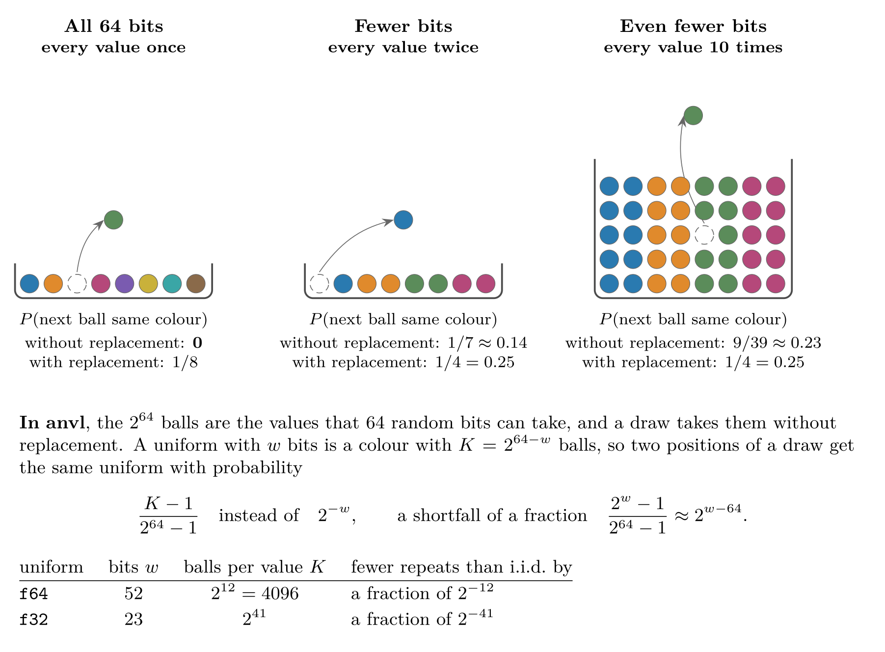
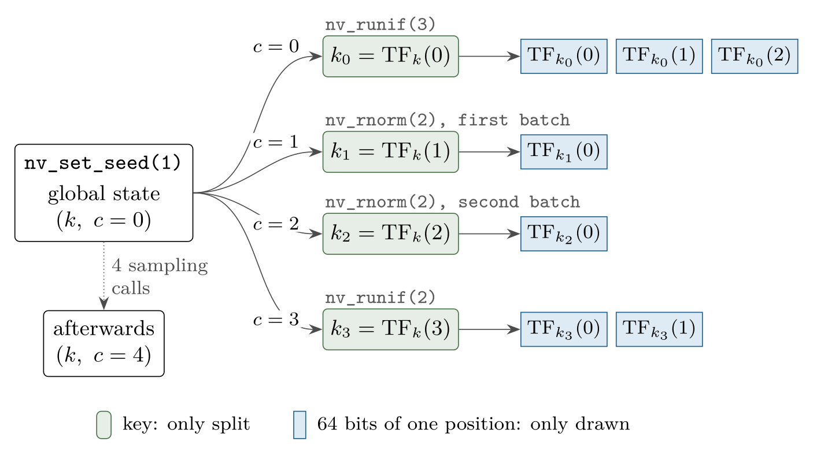
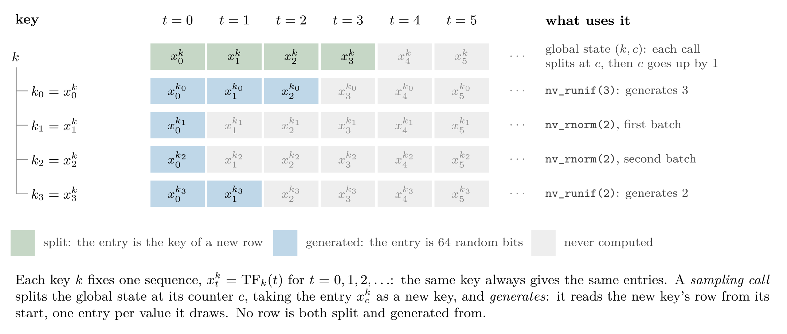

# Random Number Generation

In this article, we will explain how to generate (pseudo) random numbers
with {anvl}, which guarantees the draws come with, and how they are
generated. {anvl} uses the counter-based ThreeFry-2x32 generator (Salmon
et al. 2011), and adopts the mechanism around it, how a seed becomes a
key and how every draw derives a fresh key from it, from JAX (Bradbury
et al. 2018). The first part is what you need to use the samplers; the
[how it works](#how-it-works) part at the end describes the generator
itself.

As in base R, random number generation uses a global state, the *global
random state*, that every draw advances, and
[`nv_set_seed()`](https://r-xla.github.io/anvl/reference/nv_set_seed.md)
seeds it like [`set.seed()`](https://rdrr.io/r/base/Random.html) does:

``` r

library(anvl)
nv_set_seed(42L)
nv_runif(3L)
#> AnvlArray
#>  0.5303
#>  0.3134
#>  0.9015
#> [ CPUf32{3} ]
nv_runif(3L)
#> AnvlArray
#>  0.7277
#>  0.7879
#>  0.1817
#> [ CPUf32{3} ]
nv_set_seed(42L)
nv_runif(3L)
#> AnvlArray
#>  0.5303
#>  0.3134
#>  0.9015
#> [ CPUf32{3} ]
```

Calling
[`nv_set_seed()`](https://r-xla.github.io/anvl/reference/nv_set_seed.md)
is optional. Without it, the first draw derives the global random state
from base R’s RNG, so a
[`set.seed()`](https://rdrr.io/r/base/Random.html) before the first draw
makes the draws reproducible as well. This happens only once, though:
after the first draw, calling
[`set.seed()`](https://rdrr.io/r/base/Random.html) again does not reseed
{anvl}’s random state; call
[`nv_set_seed()`](https://r-xla.github.io/anvl/reference/nv_set_seed.md)
for that.

The available samplers are listed in the
[distributions](https://r-xla.github.io/anvl/reference/index.html#distributions)
section of the reference. For example, below we sample a matrix of shape
\\2 \times 3\\ from a normal distribution.

``` r

nv_rnorm(c(2, 3), mean = 0, sd = 1)
#> AnvlArray
#>  -1.3997  0.4528 -0.3138
#>  -1.7328 -0.8014  0.4427
#> [ CPUf32{2,3} ]
```

The samplers draw at the default float data type, `f32` unless set
otherwise (see
[`default_dtypes()`](https://r-xla.github.io/anvl/reference/default_dtypes.md)).
For more precision, draw at `f64`, per call with `dtype = "f64"` or for
all calls with
`options(anvl.default_dtypes = c(float = "f64", int = "i32"))`.

## Seeding for a scope

[`with_nv_seed()`](https://r-xla.github.io/anvl/reference/nv_set_seed.md)
and
[`local_nv_seed()`](https://r-xla.github.io/anvl/reference/nv_set_seed.md)
are the counterparts of
[`withr::with_seed()`](https://withr.r-lib.org/reference/with_seed.html)
and
[`withr::local_seed()`](https://withr.r-lib.org/reference/with_seed.html).
They seed the global random state for one expression or for the calling
function only, and restore the random state from before afterwards, so
the draws around them are not affected:

``` r

nv_set_seed(1L)
with_nv_seed(42L, nv_runif(2L))
#> AnvlArray
#>  0.5303
#>  0.3134
#> [ CPUf32{2} ]
with_nv_seed(42L, nv_runif(2L))
#> AnvlArray
#>  0.5303
#>  0.3134
#> [ CPUf32{2} ]
# the global random state continues as if the two calls had not happened
nv_runif(2L)
#> AnvlArray
#>  0.7026
#>  0.2348
#> [ CPUf32{2} ]
nv_set_seed(1L)
nv_runif(2L)
#> AnvlArray
#>  0.7026
#>  0.2348
#> [ CPUf32{2} ]
```

Inside a function,
[`local_nv_seed()`](https://r-xla.github.io/anvl/reference/nv_set_seed.md)
keeps the seed until the function returns:

``` r

simulate <- function(n) {
  local_nv_seed(123L)
  nv_rnorm(n)
}
simulate(3L)
#> AnvlArray
#>  0.8457
#>  0.2334
#>  0.1786
#> [ CPUf32{3} ]
simulate(3L)
#> AnvlArray
#>  0.8457
#>  0.2334
#>  0.1786
#> [ CPUf32{3} ]
```

## Seeds and random states

A seed and a random state are two different things, as in base R, where
[`set.seed()`](https://rdrr.io/r/base/Random.html) takes a seed and
`.Random.seed` holds the random state. The *random state* is the whole
state of the generator, which every draw advances. In {anvl}, it
consists of two 64-bit numbers, a *key* and a *counter*:

- The key decides which numbers the draws give, and draws never change
  it.
- The counter counts the *sampling calls* made with the key. A sampling
  call draws its numbers from a fresh key, which it derives from the key
  and the counter, and then increments the counter by one.

A *seed* is only a way to choose a random state to start from:
[`nv_set_seed()`](https://r-xla.github.io/anvl/reference/nv_set_seed.md)
turns the 32-bit integer it is given into a key and sets the counter to
0. Without
[`nv_set_seed()`](https://r-xla.github.io/anvl/reference/nv_set_seed.md),
the first draw instead builds the key from two uniforms of base R’s
[`runif()`](https://rdrr.io/r/stats/Uniform.html), each scaled to a
32-bit integer, and sets the counter to 0.
[`nv_get_rng_state()`](https://r-xla.github.io/anvl/reference/nv_set_seed.md)
returns a copy of the global random state, an `AnvlRngState`, which
prints the key and the counter in hexadecimal:

``` r

nv_set_seed(42L)
nv_get_rng_state()
#> <AnvlRngState> key 0x000000000000002a, counter 0x0000000000000000
```

The seed `42L` gave the key `0x2a`, which is 42 in hexadecimal. Draws
keep the key and advance the counter:
[`nv_runif()`](https://r-xla.github.io/anvl/reference/nv_uniform.md)
makes one sampling call, and
[`nv_rnorm()`](https://r-xla.github.io/anvl/reference/nv_normal.md) two,
one for each of the two batches of uniforms the Box-Muller transform
takes.

``` r

invisible(nv_runif(1000L))
nv_get_rng_state()
#> <AnvlRngState> key 0x000000000000002a, counter 0x0000000000000001
invisible(nv_rnorm(3L))
nv_get_rng_state()
#> <AnvlRngState> key 0x000000000000002a, counter 0x0000000000000003
```

So a seed can only say where a sequence of draws starts, while a random
state says where in it the draws are. Not every random state starts the
sequence of a seed either: the seeds give only \\2^{32} - 1\\ of the
\\2^{64}\\ keys, one for each R integer, and a key built from base R’s
RNG is almost never one of them.

The [splitting keys](#splitting-keys) section describes how a sampling
call derives its key.

## Saving and restoring the random state

As
[`nv_get_rng_state()`](https://r-xla.github.io/anvl/reference/nv_set_seed.md)
returns a copy, the draws after it do not advance it, and
[`nv_set_rng_state()`](https://r-xla.github.io/anvl/reference/nv_set_seed.md)
makes it the global random state again. Where
[`nv_set_seed()`](https://r-xla.github.io/anvl/reference/nv_set_seed.md)
restarts a sequence from its beginning, the two continue it where it
stopped, e.g. to resume a simulation:

``` r

nv_set_seed(42L)
rng_state <- nv_get_rng_state()
nv_runif(3L)
#> AnvlArray
#>  0.5303
#>  0.3134
#>  0.9015
#> [ CPUf32{3} ]
nv_set_rng_state(rng_state)
nv_runif(3L)
#> AnvlArray
#>  0.5303
#>  0.3134
#>  0.9015
#> [ CPUf32{3} ]
```

## Random states of their own

[`nv_rng_state()`](https://r-xla.github.io/anvl/reference/nv_rng_state.md)
creates a random state of its own from a seed.
[`with_nv_rng_state()`](https://r-xla.github.io/anvl/reference/local_nv_rng_state.md)
and, inside a function,
[`local_nv_rng_state()`](https://r-xla.github.io/anvl/reference/local_nv_rng_state.md)
make it the random state the samplers draw from, the counterparts of
[`with_nv_seed()`](https://r-xla.github.io/anvl/reference/nv_set_seed.md)
and
[`local_nv_seed()`](https://r-xla.github.io/anvl/reference/nv_set_seed.md).
A random state is a reference object: every draw from it advances it in
place, as draws from the global random state advance that, and the
global random state is left alone:

``` r

nv_set_seed(1L)
rng <- nv_rng_state(42L)
with_nv_rng_state(rng, nv_runif(3L))
#> AnvlArray
#>  0.5303
#>  0.3134
#>  0.9015
#> [ CPUf32{3} ]
with_nv_rng_state(rng, nv_runif(3L))
#> AnvlArray
#>  0.7277
#>  0.7879
#>  0.1817
#> [ CPUf32{3} ]
rng
#> <AnvlRngState> key 0x000000000000002a, counter 0x0000000000000002
# the global random state was not drawn from
nv_get_rng_state()
#> <AnvlRngState> key 0x0000000000000001, counter 0x0000000000000000
```

A random state of a seed draws what the global random state of the same
seed draws, so `nv_rng_state(42L)` above drew what `nv_set_seed(42L)`
draws. Random states of their own keep apart what should not depend on
each other, e.g. one per chain of a simulation, so that adding a draw to
one chain does not change the numbers of another.

A compiled function takes a random state as an argument, like any other,
and makes it the samplers’ random state with
[`local_nv_rng_state()`](https://r-xla.github.io/anvl/reference/local_nv_rng_state.md):

``` r

step <- jit(function(x, rng) {
  local_nv_rng_state(rng)
  x + nv_rnorm(2L) + nv_runif(2L)
})
chain_1 <- nv_rng_state(1L)
chain_2 <- nv_rng_state(2L)
step(nv_array(c(0, 0)), chain_1)
#> AnvlArray
#>   1.4441
#>  -1.0565
#> [ CPUf32{2} ]
step(nv_array(c(0, 0)), chain_2)
#> AnvlArray
#>  0.5732
#>  1.4849
#> [ CPUf32{2} ]
chain_1
#> <AnvlRngState> key 0x0000000000000001, counter 0x0000000000000003
```

The function is compiled only once, whatever random state it is passed,
and it draws what the same code run eagerly draws from it. A random
state can also be passed inside a list, e.g. one per chain in a list of
chain states.

Passing a random state to a compiled function does not by itself change
what the function draws from: only the samplers in the scope of
[`local_nv_rng_state()`](https://r-xla.github.io/anvl/reference/local_nv_rng_state.md)
or
[`with_nv_rng_state()`](https://r-xla.github.io/anvl/reference/local_nv_rng_state.md)
draw from it, and every other sampler draws from the global random state
as usual. A random state the function takes but never draws from is left
as it is:

``` r

nv_set_seed(1L)
f <- jit(function(x, rng) x + nv_runif(2L))
rng <- nv_rng_state(3L)
invisible(f(nv_array(c(0, 0)), rng))
# `nv_runif(2L)` drew from the global random state, not from `rng`
rng
#> <AnvlRngState> key 0x0000000000000003, counter 0x0000000000000000
nv_get_rng_state()
#> <AnvlRngState> key 0x0000000000000001, counter 0x0000000000000001
```

A compiled function can also draw from a random state it closes over,
rather than takes: the program then takes its key and counter as it
takes those of the global random state, reading them at every call from
the random state the function closed over when it was traced. In a
compiled function,
[`local_nv_rng_state()`](https://r-xla.github.io/anvl/reference/local_nv_rng_state.md)
cannot be called inside the body of a loop: call it before the loop, as
the random state it sets reaches the loop bodies after it.

A compiled function cannot draw from the same random state as two
different ones, though, e.g. one passed to it twice, which would draw
the same numbers: the call signals an error and leaves the random state
as it was. The [random
state](https://r-xla.github.io/anvl/articles/internals.html#the-random-state)
section of the internals article explains how a compiled function draws
from random states, also in loops and branches.

## Properties

This section summarizes what to expect from the numbers: how compiled
code draws them, how many there are before they repeat, and how
independent they are. It draws on a statistical analysis of the
generator, which ran the random bits through the TestU01 batteries
SmallCrush and Crush and through PractRand up to 256 GB, and found no
defect.

### Compiled and eager code

A compiled function draws the same numbers as the same code run eagerly,
and leaves the global random state where the eager code would leave it:

``` r

f <- function() list(nv_runif(2L), nv_rnorm(2L))
nv_set_seed(1L)
f()
#> [[1]]
#> AnvlArray
#>  0.7026
#>  0.2348
#> [ CPUf32{2} ] 
#> 
#> [[2]]
#> AnvlArray
#>  -0.3611
#>  -0.9505
#> [ CPUf32{2} ]
nv_set_seed(1L)
jit(f)()
#> [[1]]
#> AnvlArray
#>  0.7026
#>  0.2348
#> [ CPUf32{2} ] 
#> 
#> [[2]]
#> AnvlArray
#>  -0.3611
#>  -0.9505
#> [ CPUf32{2} ]
```

Every sampling call starts from a fresh key, so the size of a draw does
not change what later draws give:

``` r

nv_set_seed(1L)
invisible(nv_runif(1L))
nv_runif(3L)
#> AnvlArray
#>  0.4036
#>  0.5489
#>  0.2226
#> [ CPUf32{3} ]
nv_set_seed(1L)
invisible(nv_runif(1000L))
nv_runif(3L)
#> AnvlArray
#>  0.4036
#>  0.5489
#>  0.2226
#> [ CPUf32{3} ]
```

For the same reason, two draws of one value do not give the values of
one draw of two values:

``` r

nv_set_seed(1L)
c(as_array(nv_runif(1L)), as_array(nv_runif(1L)))
#> [1] 0.7026153 0.4036463
nv_set_seed(1L)
nv_runif(2L)
#> AnvlArray
#>  0.7026
#>  0.2348
#> [ CPUf32{2} ]
```

Within one draw, though, a value depends only on its position, so a
smaller draw is the start of a larger one:

``` r

with_nv_seed(1L, nv_runif(3L))
#> AnvlArray
#>  0.7026
#>  0.2348
#>  0.8179
#> [ CPUf32{3} ]
with_nv_seed(1L, nv_runif(6L))
#> AnvlArray
#>  0.7026
#>  0.2348
#>  0.8179
#>  0.1709
#>  0.0263
#>  0.9226
#> [ CPUf32{6} ]
```

### Period and collisions

The counter of a random state has 64 bits, and every sampling call of a
random state draws from a key of its own, distinct from those of all
other sampling calls of that random state. A random state therefore
gives \\2^{64}\\ sampling calls before its draws repeat.

Keys of *different* random states, though, are not guaranteed to be
distinct, and two sampling calls with the same key draw identical bits.
Like any 64-bit keys, they are likely to coincide somewhere once there
are about \\2^{32}\\ of them in total, by the birthday bound: with \\n\\
sampling calls spread over many random states, some two of them share a
key with probability about \\n^2 / 2^{65}\\, which is \\3 \cdot
10^{-4}\\ for \\10^8\\ calls and 3 % for \\10^9\\.

A *fork* of a random state, which
[`nv_while()`](https://r-xla.github.io/anvl/reference/nv_while.md) makes
for its loop body, is a new random state whose key is split off the
random state’s own. Forking a fork again and again chains keys, each
derived from the one before, and such a chain runs into a cycle after
about \\2^{32}\\ forks, so avoid it.

### Without replacement, almost with replacement

Every sampler starts from uniforms, and within one draw, every uniform
is made from 64 random bits of its own, and no two uniforms are made
from the same 64 bits (the [how it works](#how-it-works) section
explains why). A draw is thus a sample *without* replacement from an urn
of \\2^{64}\\ balls, where i.i.d. uniforms would be a sample *with*
replacement. A uniform has fewer bits, though: an `f64` uniform takes
one of \\2^{52}\\ values and an `f32` uniform one of \\2^{23}\\, and
fewer bits bring the two closer together. A uniform with \\w\\ bits is a
colour that \\2^{64 - w}\\ balls share, \\2^{12}\\ for `f64` and
\\2^{41}\\ for `f32`, and once every colour has many balls, drawing one
ball barely changes the chance of drawing its colour again:



## How it works

This part describes the generator behind the samplers, for readers who
want to know where the guarantees above come from.

### The generator

{anvl} draws random numbers with the counter-based ThreeFry-2x32
generator (Salmon et al. 2011). A counter-based generator does not step
through a sequence of internal states, as base R’s Mersenne Twister
does. Instead, it computes each random number directly, by encrypting a
*counter* \\c\\ under a *key* \\k\\, and the result
\\\mathrm{TF}\_k(c)\\ is 64 random bits. This plays well with parallel
computation, as each random number can be generated independently.
Although there are other algorithms such as Philox that are faster on
GPU (Salmon et al. 2011), we use the same algorithm on all platforms for
consistency. In the future, we might add support for other generators as
well.

ThreeFry is a *block cipher*. For a fixed key \\k\\, \\\mathrm{TF}\_k\\
maps 64 bits to 64 bits, and it can be inverted: it is a permutation of
the \\2^{64}\\ blocks of 64 bits, and without the key, its output looks
random.

### Splitting keys

A generator is *splittable* if it can derive new, independent keys from
a key, so that separate computations can draw from one seed without
coordinating with each other; see Claessen and Pałka (2013) for more on
splittable generators.

{anvl} – following the implementation of JAX – is such a generator: it
splits the key \\k\\ at the position \\c\\ into the new key
\\\mathrm{TF}\_k(c)\\, the position encrypted under the key. A random
state is a key together with the position of its next split, the
counter: every sampling call splits the key at the counter and
increments the counter.

The figure below shows the keys that the global random state derives for
this short program:

``` r

nv_set_seed(1L)
nv_runif(3L)
nv_rnorm(2L)
nv_runif(2L)
```

Each sampling call splits the global random state at its counter into a
fresh key, and draws a 64-bit block from it per value;
[`nv_rnorm()`](https://r-xla.github.io/anvl/reference/nv_normal.md)
makes two such calls. A key is either split or drawn from, never both.
Wrapping code in
[`jit()`](https://r-xla.github.io/anvl/reference/jit.md) does not change
the keys.



The figure below shows the same program from the side of the keys. A key
does not step through states: it fixes one sequence of 64-bit blocks,
\\x^k_0, x^k_1, x^k_2, \ldots\\, where \\x^k_t = \mathrm{TF}\_k(t)\\,
and the same key always gives the same sequence. Splitting takes an
entry of a key’s sequence as a new key, and generating reads a key’s
sequence from its start, one entry per value. A sampling call does both,
to two different keys: it splits the global key and generates from the
new key.



For a fixed key, \\\mathrm{TF}\_k\\ is a permutation, so the entries of
a key’s sequence are distinct: the sampling calls of one random state
get distinct keys until its counter wraps around after \\2^{64}\\ calls,
and the values of one draw distinct blocks, which the
[properties](#properties) section builds on.

### From bits to numbers

Every sampler starts from uniforms on \\\[0, 1)\\, each made from the
64-bit block of its position: an `f64` uniform reads the block’s top 52
bits as an integer \\m\\ and is \\m \\ 2^{-52}\\, and an `f32` uniform
reads the top 23 bits of the xor of the block’s two 32-bit words and is
\\m \\ 2^{-23}\\. These are the \\w\\ bits of the [without replacement,
almost with replacement](#without-replacement-almost-with-replacement)
section.

Bradbury, James, Roy Frostig, Peter Hawkins, et al. 2018. *JAX:
Composable Transformations of Python+NumPy Programs*. V. 0.11.2.
Released. <http://github.com/jax-ml/jax>.

Claessen, Koen, and Michał H. Pałka. 2013. “Splittable Pseudorandom
Number Generators Using Cryptographic Hashing.” *Proceedings of the 2013
ACM SIGPLAN Symposium on Haskell*, 47–58.
<https://doi.org/10.1145/2503778.2503784>.

Salmon, John K., Mark A. Moraes, Ron O. Dror, and David E. Shaw. 2011.
“Parallel Random Numbers: As Easy as 1, 2, 3.” *Proceedings of the 2011
International Conference for High Performance Computing, Networking,
Storage and Analysis*. <https://doi.org/10.1145/2063384.2063405>.
