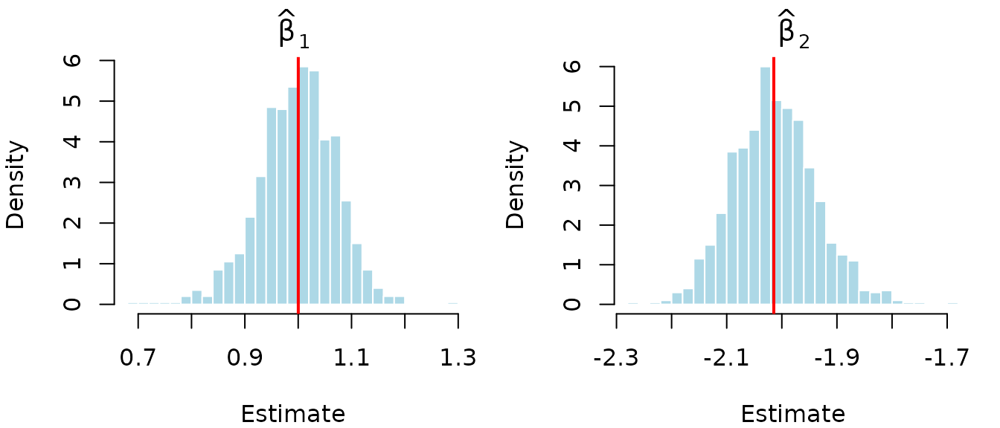
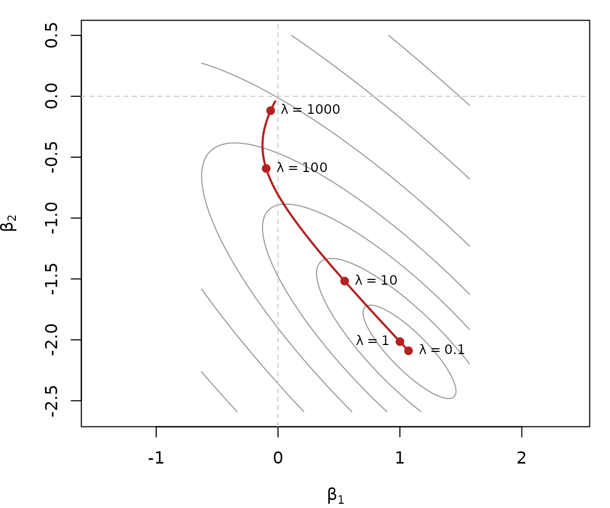
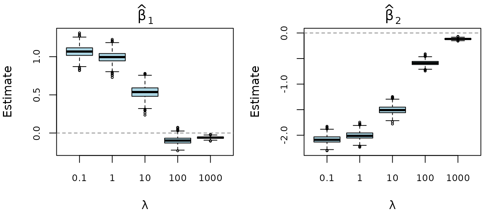

# Vectorization

``` r

library(anvl)
```

It is often easier to write a function that operates on “one unit” of
the data, such as a single vector or matrix. As an example, we implement
ridge regression the standard way, i.e., by solving the penalized normal
equations: \\ (X^\top X + \lambda I) \hat\beta = X^\top y. \\ The data
are a design matrix \\X \in \mathbb{R}^{100 \times 2}\\, with 100
observations of 2 correlated predictors, and the response \\y\\, a
matrix with 100 rows and one column.

Click to show how the data are generated

``` r

nv_set_seed(1L)
n <- 100L
beta <- nv_array(c(1, -2), shape = c(2L, 1L))

# two predictors with a correlation of 0.8
X <- nv_rnorm(c(n, 2L)) %*% nv_array(c(1, 0, 0.8, 0.6), shape = c(2L, 2L))
y <- X %*% beta + nv_rnorm(c(n, 1L), sd = 0.5)
```

Below is our model fitting function:

``` r

ridge <- jit(function(X, y, lambda) {
  XtX <- t(X) %*% X
  nv_solve(XtX + lambda * diag(ncol(X)), t(X) %*% y)
})

ridge(X, y, lambda = 1)
#> AnvlArray
#>   1.0002
#>  -2.0146
#> [ CPUf32{2,1} ]
```

In order to quantify the uncertainty of the \\\hat\beta\\, we will use
bootstrapping. One way to do this is to just loop over every bootstrap
sample and call the model fitting function on each.

``` r

B <- 1000L
idx <- nv_sample_int(c(n, B), n)

fit_sample <- jit(function(i, X, y, lambda) ridge(X[i, ], y[i, ], lambda))

coefs_loop <- lapply(seq_len(B), function(b) fit_sample(idx[, b], X, y, lambda = 1))
coefs_loop <- do.call(nv_cbind, coefs_loop)
shape(coefs_loop)
#> [1]    2 1000
```

What
[`vectorize()`](https://r-xla.github.io/anvl/dev/reference/vectorize.md)
allows is to replace the iterative loop through a single “vectorized”
call that processes all iterations at once. We call this transformation
[`vectorize()`](https://r-xla.github.io/anvl/dev/reference/vectorize.md)
because it is in the spirit of
[`base::Vectorize`](https://rdrr.io/r/base/Vectorize.html), although it
is more general. Unlike
[`base::Vectorize`](https://rdrr.io/r/base/Vectorize.html), which maps a
function over the elements of its arguments,
[`vectorize()`](https://r-xla.github.io/anvl/dev/reference/vectorize.md)
maps it over slices along an axis: over the columns of a matrix, for
example, not over its elements. In other array computing frameworks this
functionality is often called `vmap` (for “vectorized map”).

For every argument we need to specify whether it varies between every
iteration or not. By default (`in_axes = -1L`),
[`vectorize()`](https://r-xla.github.io/anvl/dev/reference/vectorize.md)
maps over the last axis of every argument that is an array with at least
one axis. A scalar, such as `lambda = 1`, has no axis, so it is never
mapped over: every application gets it as it is. In our case, only the
bootstrap sample index `i` varies between iterations and the different
iterations are stored along the trailing batch axis (`i = -1L`):

``` r

bootstrap <- jit(vectorize(fit_sample, in_axes = list(i = -1L)))
coefs <- bootstrap(idx, X, y, lambda = 1)
shape(coefs)
#> [1]    2    1 1000
```

The batch axis can be any axis of an argument, but we recommend the last
one, as `idx` does with one sample per column. This plays well with the
column-major layout of anvl’s arrays: the slices along the last axis are
contiguous in memory.

The results are stacked along a trailing batch axis, i.e.,
`coefs[, 1, b]` is the estimate of the `b`-th sample, and the bootstrap
standard errors are the standard deviations along that axis:

``` r

nv_sd(coefs, axes = 3L)
#> AnvlArray
#>  0.0726
#>  0.0756
#> [ CPUf32{2,1} ]
```

The histograms show the bootstrap distribution of each coefficient
around its estimate on all data (red):



The advantage of the vectorized version over the manual loop is that it
can run faster. Moreover, we might want to map across different axes.
For example, instead of mapping over bootstrap samples, we might want to
look at how the estimates change with different penalty values:

``` r

lambdas <- nv_array(c(0.1, 1, 10, 100, 1000), dtype = "f32")

ridge_path <- jit(vectorize(ridge, in_axes = list(lambda = -1L)))
ridge_path(X, y, lambdas)
#> AnvlArray
#> (1,.,.) =
#>   1.0706  1.0002  0.5464 -0.0973 -0.0607
#> 
#> (2,.,.) =
#>  -2.0896 -2.0146 -1.5176 -0.5932 -0.1181
#> [ CPUf32{2,1,5} ]
```

The contour lines show the residual sum of squares \\\\y - X\beta\\^2\\,
which is smallest at the least squares estimate. The larger the penalty,
the further it pulls the estimate away from there towards zero, along
the ridge path (red) over a finer grid of penalties:



So far, the bootstrap samples were drawn up front and passed in as
`idx`. Instead, `fit_resample()` draws its sample itself (see the
[random
numbers](https://r-xla.github.io/anvl/dev/articles/random-numbers.md)
article). It then has no data to map over, so we map it over the
replicate numbers, which it does not use, like
`lapply(seq_len(B), function(b) ...)` does:

``` r

fit_resample <- jit(function(b, X, y, lambda) {
  i <- nv_sample_int(nrow(X), nrow(X))
  ridge(X[i, ], y[i, ], lambda)
})
replicates <- nv_seq(1L, B)

bootstrap_resample <- jit(vectorize(fit_resample, in_axes = list(b = -1L)))
coefs <- with_nv_seed(1L, bootstrap_resample(replicates, X, y, lambda = 1))
```

Every replicate draws a sample of its own, and
[`vectorize()`](https://r-xla.github.io/anvl/dev/reference/vectorize.md)
guarantees that these are the random numbers a loop applying
`fit_resample()` to one replicate after the other draws; the random
state also advances as it does after that loop. So vectorizing a
simulation changes how fast it runs, not its results: from the same
seed, set for both with
[`with_nv_seed()`](https://r-xla.github.io/anvl/dev/reference/nv_set_seed.md),
the loop gives the same estimates.

``` r

coefs_loop <- with_nv_seed(1L, {
  lapply(seq_len(B), function(b) fit_resample(replicates[b], X, y, lambda = 1))
})
coefs_loop <- do.call(nv_cbind, coefs_loop)

all.equal(as_array(coefs)[, 1L, ], as_array(coefs_loop))
#> [1] TRUE
```

With `randomness = "common"` (`randomness = "same"` in PyTorch’s
`torch.func.vmap()`), the slices draw common random numbers: every slice
draws the ones a single application of the function draws, and the
random state advances as after that application. That is what a
bootstrap of the ridge path needs within a replicate: every penalty is
fitted on the same sample, so that the estimates differ only by the
penalty. So the inner
[`vectorize()`](https://r-xla.github.io/anvl/dev/reference/vectorize.md)
maps `fit_resample()` over the penalties with `randomness = "common"`,
and the outer one maps that over the replicates with the default
`randomness = "independent"`, so that every replicate draws a sample of
its own:

``` r

path_resample <- vectorize(fit_resample, in_axes = list(lambda = -1L), randomness = "common")
bootstrap_path <- jit(vectorize(path_resample, in_axes = list(b = -1L)))

paths <- with_nv_seed(1L, bootstrap_path(replicates, X, y, lambdas))
shape(paths)
#> [1]    2    1    5 1000
```

Every call appends its batch axis, so `paths[, 1, l, b]` is the estimate
for the `l`-th penalty on the `b`-th sample. The boxplots show the
bootstrap distribution of each coefficient for every penalty:



A function that
[`vectorize()`](https://r-xla.github.io/anvl/dev/reference/vectorize.md)
maps over can also contain loops and branches whose course depends on
the values mapped over. Such a loop runs a different number of times for
every slice.
[`vectorize()`](https://r-xla.github.io/anvl/dev/reference/vectorize.md)
runs it until the condition fails for every slice, and a slice whose
condition has failed keeps its state from then on, so every slice ends
where a loop over the slices leaves it. Newton’s method for the square
root, for example, stops once its step is small, which takes more steps
the larger the number:

``` r

newton_sqrt <- function(a) {
  nv_while(list(x = a, step = a), function(x, step) abs(step) > 1e-10 * x, function(x, step) {
    x_new <- (x + a / x) / 2
    list(x = x_new, step = x - x_new)
  })$x
}
jit(vectorize(newton_sqrt))(nv_array(c(2, 9, 1e6), dtype = "f64"))
#> AnvlArray
#>     1.4142
#>     3.0000
#>  1000.0000
#> [ CPUf64{3} ]
```

Likewise, when the predicate of
[`nv_if()`](https://r-xla.github.io/anvl/dev/reference/nv_if.md) depends
on the values mapped over, every branch that some slice takes runs, and
each slice keeps the result of its own branch. A slice runs a branch it
does not take on the values of a slice that takes it, so the branch
never sees values it is not meant for: mapped over an `x` with a `0` in
it, the gradient of `nv_if(x > 0, function() sqrt(x), function() x)` is
`1` there, not `NaN`, as that slice does not take the
[`sqrt()`](https://rdrr.io/r/base/MathFun.html). What a loop body or a
branch does for a slice that is done with the loop or does not take the
branch is discarded, except for its side effects:
[`nv_print()`](https://r-xla.github.io/anvl/dev/reference/nv_print.md)
prints for those slices, too.

Beyond this,
[`vectorize()`](https://r-xla.github.io/anvl/dev/reference/vectorize.md)
can map over parts of nested list arguments, place the batch axis of
every output with `out_axes`, and compose with other transformations;
see
[`?vectorize`](https://r-xla.github.io/anvl/dev/reference/vectorize.md)
for more.
