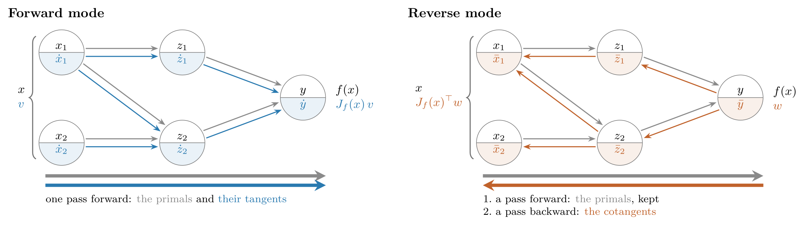

```{r, include = FALSE}
knitr::opts_chunk$set(
  collapse = TRUE,
  comment = "#>"
)
```

In this article, you will learn how to compute derivatives of functions with {anvl}.
If you haven't yet, read the [Get Started](anvl.html) article first, which uses gradients to fit a linear model.

{anvl} differentiates a function in one of two modes: *forward mode* computes its *pushforward*, and *reverse mode* its *pullback*.
Both are products of the Jacobian of the function with a vector.
For $f: \mathbb{R}^n \to \mathbb{R}^m$, the Jacobian at $x$ is the $m \times n$ matrix $J_f(x)$ whose entry $(i, j)$ is the derivative of the $i$-th element of the result with respect to the $j$-th element of the arguments:

$$
J_f(x) = \begin{pmatrix}
  \frac{\partial f_1}{\partial x_1}(x) & \cdots & \frac{\partial f_1}{\partial x_n}(x) \\
  \vdots & \ddots & \vdots \\
  \frac{\partial f_m}{\partial x_1}(x) & \cdots & \frac{\partial f_m}{\partial x_n}(x)
\end{pmatrix}
$$

The pushforward and the pullback of $f$ at $x$ are the linear maps

$$
\text{pushforward: } v \mapsto J_f(x) \, v
\qquad\qquad
\text{pullback: } w \mapsto J_f(x)^\top w
$$

- The pushforward takes a direction to move the arguments in -- their *tangent* $v \in \mathbb{R}^n$ -- to the derivative of the result along that direction.
  With the $j$-th unit vector as $v$, it gives the $j$-th column of the Jacobian: the derivatives of all elements of the result with respect to the $j$-th element of the arguments.
- The pullback takes a *cotangent* $w \in \mathbb{R}^m$ -- a weight for each element of the result -- back to the arguments, to the gradient of the weighted sum $\sum_{i=1}^m w_i f_i(x)$.
  With the $i$-th unit vector as $w$, it gives the $i$-th row of the Jacobian: the derivatives of the $i$-th element of the result with respect to all elements of the arguments.

`pushforward()` and `pullback()` compute them.
Each takes a function and the arguments to evaluate it at, as a call of the function would, and returns the pushforward or the pullback there, as a function of the tangent or of the cotangent.
For the elementwise square $f(x) = x^2$, the Jacobian is diagonal with entries $2 x_i$, so the pushforward and the pullback along the first unit vector both give $(2 x_1, 0, 0)$, its first column and its first row:

```{r}
library(anvl)

f <- function(x) x^2L
x <- nv_array(c(1, 2, 3))
e1 <- nv_array(c(1, 0, 0))

f_pushforward <- jit(function(x, v) pushforward(f, x)(v))
f_pushforward(x, e1)

f_pullback <- jit(function(x, w) pullback(f, x)(w))
f_pullback(x, e1)
```

The pushforward takes the tangents as the function takes its arguments, and returns the tangent of the result, structured like the result.
The pullback takes a cotangent structured like the result, and returns a named list with one derivative per argument.
In a cotangent, `NULL` stands for zeros, in place of a single array or of a whole sublist of arrays:

```{r}
stats <- function(x) list(total = sum(x), squares = x^2L)
stats_pullback <- jit(function(x) pullback(stats, x)(list(total = 1, squares = NULL)))
stats_pullback(x)
```

Neither mode builds the full Jacobian itself, as that would be far more costly: it would take products of the Jacobians of the steps, which are matrices, while a product with a vector takes one product of a matrix with a vector per step.
Take a function of two steps, $f(x) = g(h(x))$, with the intermediate result $z = h(x) \in \mathbb{R}^l$.
By the chain rule, its Jacobian is the product of the Jacobians of the two steps, of sizes $m \times l$ and $l \times n$:

$$J_f(x) = J_g(z) \, J_h(x)$$

Multiplied with a vector, this product can be evaluated in an order in which every intermediate result is a vector, so each step only needs the product of its Jacobian with a vector, which its derivative rule computes directly:

- Forward mode evaluates it from the right, $J_f(x) v = J_g(z) \, (J_h(x) \, v)$.
  $J_h(x) v$ is the tangent of $z$, computed along with $z$ itself, and $J_g(z)$ applied to it gives the tangent of the result, along with the result.
- Reverse mode evaluates it from the left, $J_f(x)^\top w = J_h(x)^\top \, (J_g(z)^\top w)$.
  The first product needs $J_g$ at $z$, a value the function only computes on its way to the result, so the function has to run forward first.

A function of many steps works the same way, on its *computational graph*, whose nodes are the values the function computes -- the *primals* -- and whose edges lead from the operands of each step to its result.
The figure below shows both modes on the same graph.
Forward mode (left) pushes the primals and their tangents through the graph together, in a single pass from the arguments to the result: every step computes the tangent of its result from the primals and tangents of its operands.
Reverse mode (right) takes two passes.
The first runs the function forward, computing the primals and keeping those that the derivative rules need.
The second goes backward, from the result to the arguments: every step passes the cotangent of its result on to its operands, and a primal that several steps use, such as $x_1$, sums the cotangents they pass it.

```{r, echo = FALSE, out.width = "100%", fig.align = "center"}

```

So reverse mode needs memory for the primals it keeps, which forward mode does not.

Applied to all unit vectors at once, the two orders multiply the Jacobian with an identity matrix: forward mode with $I_n$ from the right, one pushforward per column, and reverse mode with $I_m$ from the left, one pullback per row:

$$
\text{forward: } J_f(x) \, I_n
\qquad\qquad
\text{reverse: } I_m \, J_f(x)
$$

Both give the whole Jacobian, but each pushforward and each pullback costs a small multiple of evaluating $f$, so the work grows with $n$ in forward mode and with $m$ in reverse mode.
Reverse mode is therefore cheaper when $n \gg m$, and forward mode when $n \ll m$.

For a function whose result is a single float scalar, such as a loss, the pullback of the cotangent `1` is the gradient, which `gradient()` computes directly.
It returns a function with the same arguments, which returns their gradients:

```{r}
g <- function(x) mean(f(x))
g_gradient <- jit(gradient(g))
g_gradient(x)
```

The `wrt` argument of `gradient()` selects the arguments to differentiate, and `value_and_gradient()` returns the value of the function as well.

The two modes also combine: the pushforward of the gradient along $v$ is the product of the Hessian with $v$:

```{r}
g_grad_x <- function(x) gradient(g)(x)$x
hvp <- jit(function(x, v) pushforward(g_grad_x, x)(v))
hvp(x, e1)
```

Differentiating the gradient in forward mode, *forward over reverse*, is the standard way to compute such Hessian-vector products: one costs a small constant multiple of evaluating the function.
A full Hessian takes $n$ of them, one per column, or fewer when it is sparse.
See @griewank2008evaluating [chapters 5 and 8] for more.

Some functions, such as `abs()`, `max()` or a comparison like `x > 0`, are differentiable everywhere except on a set of measure zero; a comparison is constant almost everywhere, so its derivative is zero there.
At the points where they are not differentiable, {anvl} follows the conventions of other frameworks such as PyTorch.
For example, `nv_ifelse(x > 0, x, 0)` only uses the comparison to select values, so the gradient is `1` where `x` is positive and `0` elsewhere:

```{r}
relu_sum <- function(x) sum(nv_ifelse(x > 0, x, 0))
relu_sum_gradient <- jit(gradient(relu_sum))
relu_sum_gradient(nv_array(c(-1, 2)))
```

For how {anvl} computes derivatives, see the [transforming graphs into other graphs](internals.html#transforming-graphs-into-other-graphs) and [`gradient()`](internals.html#gradient) sections of the internals article, and for how to write the derivative rules of a primitive, the [Adding a Primitive](extending_primitive.html) article.
