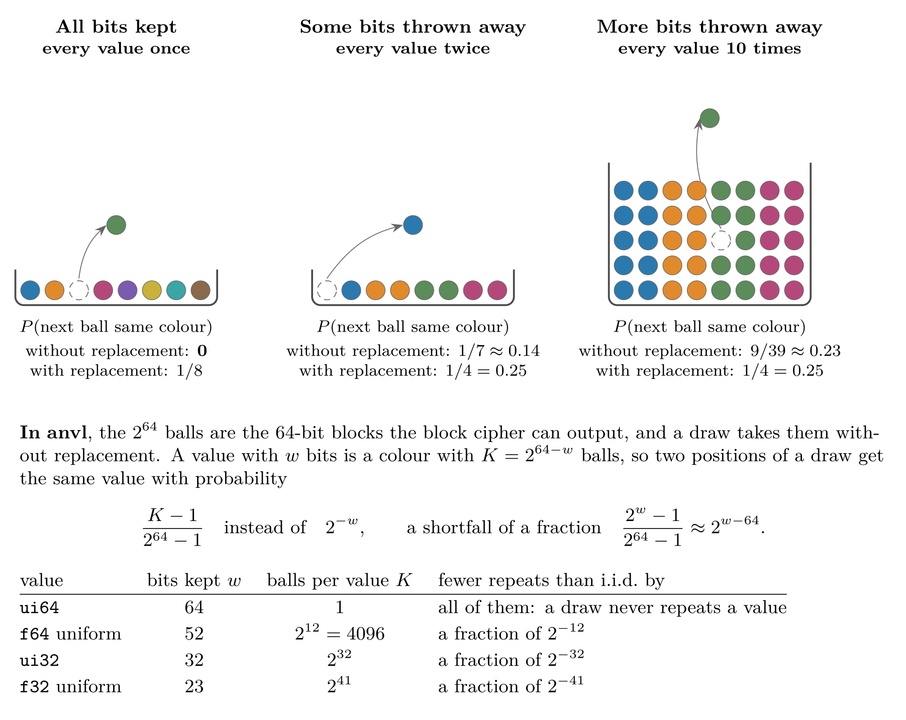
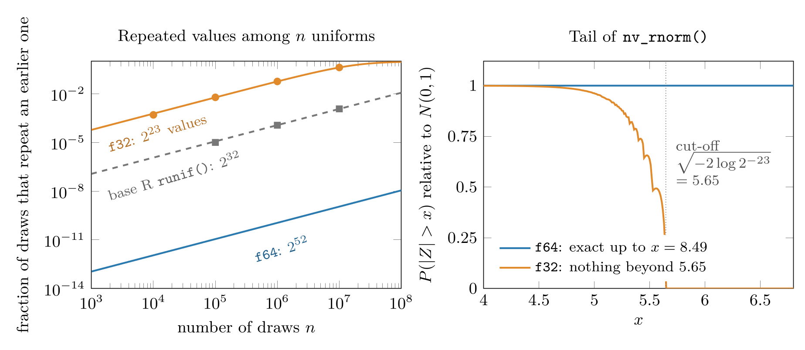
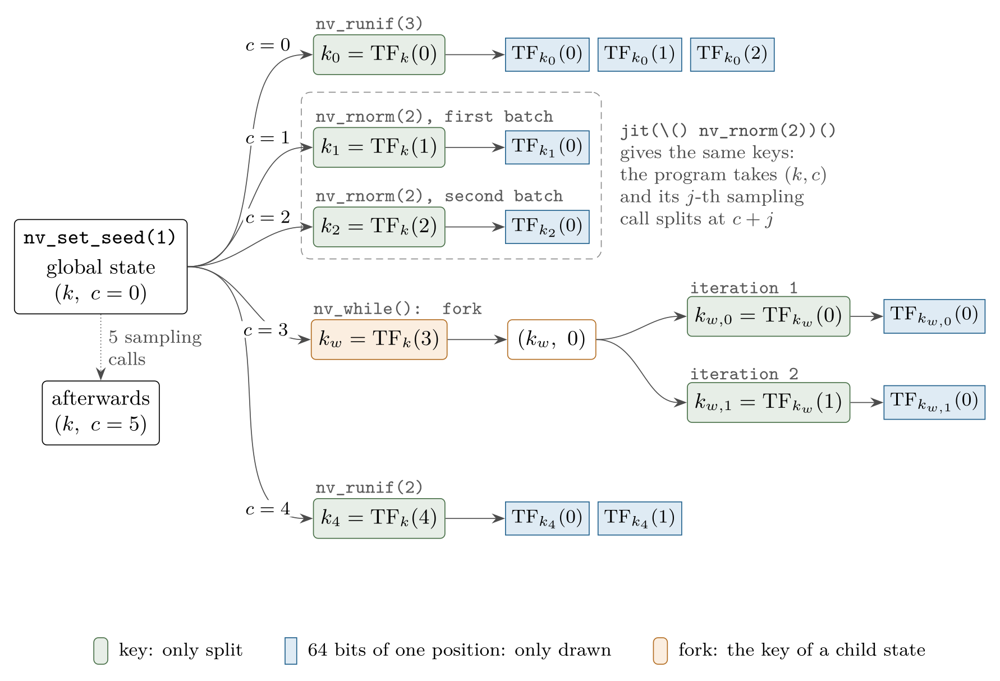
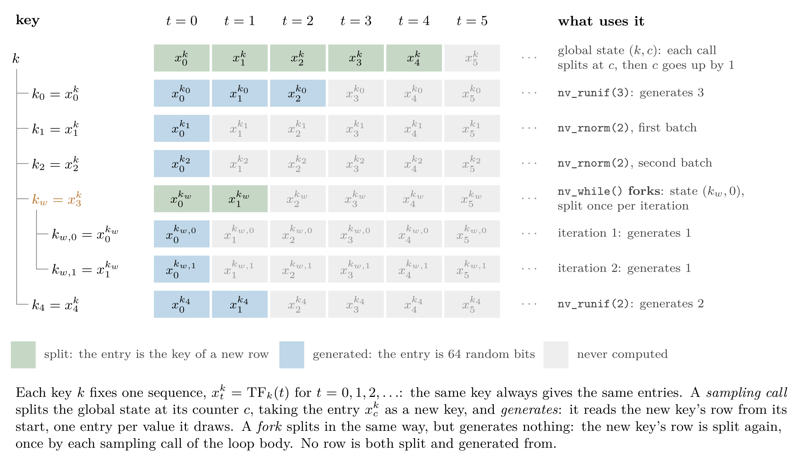
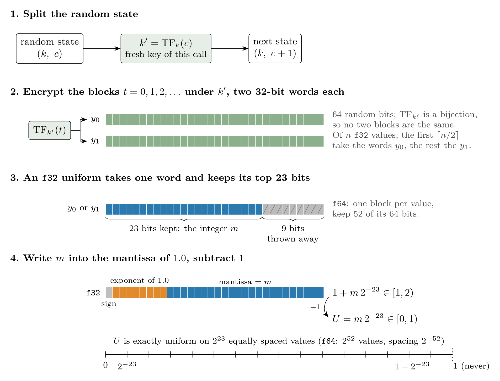

```{r, include = FALSE}
knitr::opts_chunk$set(
  collapse = TRUE,
  comment = "#>"
)
```

In this article, we will explain how to draw (pseudo) random numbers with {anvl}, which guarantees the draws come with, and how they are generated.
The first part is what you need to use the samplers; the [how it works](#how-it-works) part at the end describes the generator itself and can be skipped.

As in base R, random number generation uses a global state, the *global random state*, that every draw advances, and `nv_set_seed()` seeds it like `set.seed()` does:

```{r}
library(anvl)
nv_set_seed(42L)
nv_runif(3L)
nv_runif(3L)
nv_set_seed(42L)
nv_runif(3L)
```

Calling `nv_set_seed()` is optional.
While the global random state is not set, the first draw derives it from base R's RNG, so a `set.seed()` before the first draw makes the draws reproducible as well.
This happens only once, though: after the first draw, calling `set.seed()` again does not reseed {anvl}'s random state; call `nv_set_seed()` for that.

The available samplers are listed in the [distributions](../reference/index.html#distributions) section of the reference.
For example, below we sample a matrix of shape $2 \times 3$ from a normal distribution.

```{r}
nv_rnorm(c(2, 3), mean = 0, sd = 1)
```

To draw integers, use `nv_sample_int()`, the counterpart to R's `sample.int()`:

```{r}
# roll six dice
nv_sample_int(6L, 6L)
```

`nv_sample()` draws from an arbitrary population instead.
Unlike R's `sample()`, its population argument is never overloaded with a count, so `nv_sample(5L, nv_array(6))` samples from the population `6` rather than from `1:6`:

```{r}
population <- nv_array(c(10, 20, 30))
nv_sample(8L, population)
```

## Seeding for a scope

`with_nv_seed()` and `local_nv_seed()` are the counterparts of `withr::with_seed()` and `withr::local_seed()`.
They seed the global random state for one expression or for the calling function only, and restore the random state from before afterwards, so the draws around them are not affected:

```{r}
nv_set_seed(1L)
with_nv_seed(42L, nv_runif(2L))
with_nv_seed(42L, nv_runif(2L))
# the global random state continues as if the two calls had not happened
nv_runif(2L)
nv_set_seed(1L)
nv_runif(2L)
```

Inside a function, `local_nv_seed()` keeps the seed until the function returns:

```{r}
simulate <- function(n) {
  local_nv_seed(123L)
  nv_rnorm(n)
}
simulate(3L)
simulate(3L)
```

## Saving and restoring the random state

`nv_get_random_state()` returns a copy of the global random state, a key and a counter, as `AnvlArray`s; `nv_set_random_state()` makes a saved random state the global random state again.
Where `nv_set_seed()` restarts a sequence from its beginning, the two continue it where it stopped, e.g. to resume a simulation:

```{r}
nv_set_seed(42L)
random_state <- nv_get_random_state()
nv_runif(3L)
nv_set_random_state(random_state)
nv_runif(3L)
```

Like any array, the random state can be written to a file with `saveRDS()` and read back with `readRDS()`:

```{r}
path <- tempfile(fileext = ".rds")
saveRDS(nv_get_random_state(), path)
nv_set_random_state(readRDS(path))
```

The key is fixed by the seed, and the counter counts the *sampling calls* made since, not the values drawn: `nv_runif()` makes one sampling call, and `nv_rnorm()` two, one for each of the two batches of uniforms the Box-Muller transform takes.

```{r}
nv_set_seed(42L)
nv_get_random_state()
invisible(nv_runif(1000L))
nv_get_random_state()
invisible(nv_rnorm(3L))
nv_get_random_state()
```

## Random states of their own

`nv_random_state()` creates a random state of its own, from a seed or, without one, from base R's RNG.
`with_nv_rng_state()` and, inside a function, `local_nv_rng_state()` make it the random state the samplers draw from, the counterparts of `with_nv_seed()` and `local_nv_seed()`.
A random state is a reference object: every draw from it advances it in place, as draws from the global random state advance that, and the global random state is left alone:

```{r}
nv_set_seed(1L)
rng <- nv_random_state(42L)
with_nv_rng_state(rng, nv_runif(3L))
with_nv_rng_state(rng, nv_runif(3L))
rng
# the global random state was not drawn from
nv_get_random_state()
```

A random state of a seed draws what the global random state of the same seed draws, so `nv_random_state(42L)` above drew what `nv_set_seed(42L)` draws.
Random states of their own keep apart what should not depend on each other, e.g. one per chain of a simulation, so that adding a draw to one chain does not change the numbers of another.

A compiled function takes a random state as an argument, like any other, and makes it the samplers' random state with `local_nv_rng_state()`:

```{r}
step <- jit(function(x, rng) {
  local_nv_rng_state(rng)
  x + nv_rnorm(2L) + nv_runif(2L)
})
chain_1 <- nv_random_state(1L)
chain_2 <- nv_random_state(2L)
step(nv_array(c(0, 0)), chain_1)
step(nv_array(c(0, 0)), chain_2)
chain_1
```

The function is compiled only once, whatever random state it is passed, and it draws what the same code run eagerly draws from it.
A random state can also be passed inside a list, e.g. one per chain in a list of chain states.

Passing a random state to a compiled function does not by itself change what the function draws from: only the samplers in the scope of `local_nv_rng_state()` or `with_nv_rng_state()` draw from it, and every other sampler draws from the global random state as usual.
A random state the function takes but never draws from is left as it is:

```{r}
nv_set_seed(1L)
f <- jit(function(x, rng) x + nv_runif(2L))
rng <- nv_random_state(3L)
invisible(f(nv_array(c(0, 0)), rng))
# `nv_runif(2L)` drew from the global random state, not from `rng`
rng
nv_get_random_state()
```

In a compiled function, the random state must be one the function takes as an argument, and `local_nv_rng_state()` cannot be called inside the body of a loop: call it before the loop, as the random state it sets reaches the loop bodies after it.

A compiled function cannot draw from a random state it closes over, though, and the same random state cannot be passed to it twice, which would draw the same numbers.
The [random states passed to a compiled function](#random-states-passed-to-a-compiled-function) section explains how this works.

## Compiled and eager code

A compiled function draws the same numbers as the same code run eagerly, and leaves the global random state where the eager code would leave it:

```{r}
f <- function() list(nv_runif(2L), nv_rnorm(2L))
nv_set_seed(1L)
f()
nv_set_seed(1L)
jit(f)()
```

Every sampling call starts from a fresh key, so the size of a draw does not change what later draws give:

```{r}
nv_set_seed(1L)
invisible(nv_runif(1L))
nv_runif(3L)
nv_set_seed(1L)
invisible(nv_runif(1000L))
nv_runif(3L)
```

For the same reason, two draws of one value do not give the values of one draw of two values:

```{r}
nv_set_seed(1L)
c(as_array(nv_runif(1L)), as_array(nv_runif(1L)))
nv_set_seed(1L)
nv_runif(2L)
```

### Loops and branches

A loop or a branch that samples draws the numbers of the equivalent eager code where it can, but not always.
The table says, for each construct, by how many sampling calls it advances the global random state, where $N_{\mathrm{body}}$, $N_a$ and $N_b$ are the numbers of sampling calls its body or branches make, and whether it draws the numbers of the equivalent eager code:

| Construct | Advance | Same numbers as eager code |
|---|---|---|
| `nv_scan(..., steps = n)` | $n \cdot N_{\mathrm{body}}$ | yes: an R `for` loop over the body |
| `nv_if(pred, a, b)` | $\max(N_a, N_b)$, whichever branch runs | when $N_a = N_b$ |
| `nv_while(cond, body)` | $1$, however often the body runs | no |

A loop body draws from a random state that the jitted function takes as an argument by closing over it, like any other value of the function around it.
A random state cannot be part of a loop's state, the `init` of `nv_while()` or `nv_scan()`, nor of the `xs` of `nv_scan()`: the loop carries the random state itself.

`nv_scan()` draws what the same body called in an R `for` loop draws:

```{r}
step <- function() nv_runif(1L)
nv_set_seed(1L)
jit(function() nv_scan(nv_scalar(0), body = function(carry, x) list(carry = carry, out = step()), steps = 3L)$out)()
nv_set_seed(1L)
for (i in 1:3) print(as_array(step()))
```

`nv_if()` advances the random state by the larger number of sampling calls of its two branches, whichever branch runs, so the draws after it do not depend on which branch ran, and `nv_if(pred, f, f)` draws exactly what `f` draws:

```{r}
h <- jit(function(pred) nv_if(pred, function() nv_runif(1L), function() nv_rnorm(1L)))
nv_set_seed(1L)
invisible(h(TRUE))
nv_get_random_state()
nv_set_seed(1L)
invisible(h(FALSE))
nv_get_random_state()
```

`nv_while()` runs its body a number of times that is not known when the function is compiled.
Its body therefore draws from a random state of its own, and the global random state advances by one, however often the body ran:

```{r}
walk <- jit(function(n) {
  nv_while(
    list(i = 0L, pos = nv_scalar(0)),
    function(i, pos) i < n,
    function(i, pos) list(i = i + 1L, pos = pos + nv_rnorm(integer()))
  )$pos
})
for (n in c(1L, 10L, 100L)) {
  nv_set_seed(1L)
  walk(n)
  print(nv_get_random_state())
}
```

So the numbers an `nv_while()` loop draws differ from those of the same body run in an R `while` loop.
Moving a prototype from an R `while` loop to `nv_while()` therefore changes the numbers, as does adding the first sampling call to a loop body that did not make one before.

The function that `gradient()` differentiates runs once, so it advances the random state by its number of sampling calls, like straight-line code.
Sampling is not possible in the condition of `nv_while()`, nor in the functions of a reduction or a scatter.

## Properties

This section summarizes what to expect from the numbers: how many there are before they repeat, how independent they are, and how precise.
It draws on a statistical analysis of the generator, which ran the random bits through the TestU01 batteries SmallCrush and Crush and through PractRand up to 256 GB, and found no defect.

### Period and collisions

The counter of a random state has 64 bits, and every sampling call of a random state draws from a key of its own, distinct from those of all other sampling calls of that random state.
A random state therefore gives $2^{64}$ sampling calls before its draws repeat, far more than any program makes.

Keys of *different* random states, though, are not guaranteed to be distinct, and two sampling calls with the same key draw identical bits.
Like any 64-bit keys, they are likely to coincide somewhere once there are about $2^{32}$ of them in total, by the birthday bound: with $n$ sampling calls spread over many random states, some two of them share a key with probability about $n^2 / 2^{65}$, which is $3 \cdot 10^{-4}$ for $10^8$ calls and 3 % for $10^9$.
One seed whose random state makes all the calls never repeats a key, so prefer one `nv_set_seed()` followed by all the draws of a simulation over calling `nv_set_seed()` with a new seed for every replicate.
JAX's generator has the same property.

For the same reason, do not continue with a fork of the random state again and again, e.g. by making the random state that `prim_fork_random_state()` returns the global one in every iteration of a loop: each fork derives its key from the previous one, and such a chain of keys runs into a cycle after about $2^{32}$ forks.

### Without replacement, almost with replacement

Within one draw, no two blocks of 64 random bits are the same (the [how it works](#how-it-works) section explains why): a 64-bit value takes a block, and a 32-bit or narrower value one of a block's two 32-bit words.
A draw is thus a sample *without* replacement from an urn of $2^{64}$ balls, where i.i.d. values would be a sample *with* replacement.
The values the samplers use keep only some of these bits, and throwing bits away is what makes the two almost the same.
Each value with $w$ bits is a colour that $2^{64 - w}$ balls share, and once every colour has many balls, drawing one ball barely changes the chance of drawing its colour again:

```{r, echo = FALSE, out.width = "100%"}

```

Only statistics built on repeated values, such as counts of ties, can see this, and even they hardly can: counting the repeats of `f64` uniforms in the largest possible draws reveals the shortfall only after about $6 \cdot 10^{14}$ values.
Throwing bits away does not remove the dependence, though; it buries it among the repeats that $2^w$ values have anyway.
The correlation between any function of the value at one position and the same function of the value at another is $-1 / (2^{64} - 1)$, whatever $w$, and $0$ for the two narrower values that share a block.
This leaves Monte Carlo averages exactly unbiased, and makes their variance smaller than for i.i.d. values by the factor $(2^{64} - n) / (2^{64} - 1)$, so the usual standard errors are conservative, by less than $10^{-10}$.
Draws of different sampling calls use different keys, so this dependence is confined to a single draw.

### `f32` and `f64`

The default float data type is `f32` (see `default_dtypes()`), and an `f32` uniform is exactly uniform on a grid of only $2^{23} \approx 8.4$ million equally spaced values, where an `f64` uniform takes $2^{52}$ values.
Where samples are many, or where their tails matter, the coarse `f32` grid shows, as the figure below illustrates:

* *Ties.* Among $10^6$ `f32` uniforms, 5.7 % repeat an earlier one, against about 0.01 % for base R's `runif()`, whose grid has $2^{32}$ values, and none for `f64`.
* *Tails.* `nv_rnorm()` uses the Box-Muller transform, whose radius $\sqrt{-2 \log U}$ cannot exceed $\sqrt{-2 \log 2^{-23}} = 5.65$ for `f32`.
  An `f32` normal is never larger than that in absolute value, and the tail before it is too thin already: beyond $5.45$ (the genome-wide significance threshold of $5 \cdot 10^{-8}$) it has only 64 % of the mass of $N(0, 1)$.
  For `f64` the limit is $8.49$, and the tails match $N(0, 1)$.
* *Shifted intervals.* `nv_runif(n, 1e6, 1e6 + 1)` at `f32` takes only 17 distinct values, and returns the end points of the interval, because the scaled and shifted uniform is rounded to the coarser grid of floats around $10^6$.

```{r, echo = FALSE, out.width = "100%"}

```

For simulations whose results depend on such details, draw at `f64`, either per call with `dtype = "f64"` or for all calls by making it the default float:

```{r, eval = FALSE}
options(anvl.default_dtypes = c(float = "f64", int = "i32"))
```

`nv_rbinom()`, `nv_sample_int()` and `nv_sample()` always draw `f64` uniforms internally, whatever the default float.

## How it works

This part describes the generator behind the samplers, for readers who want to know where the guarantees above come from.

### The generator

{anvl} draws random numbers with the counter-based ThreeFry-2x32 generator [@salmon2011parallel].
A counter-based generator does not step through a sequence of internal states, as base R's Mersenne Twister does.
Instead, it computes each random number directly, by encrypting a *counter* $c$ under a *key* $k$, and the result $\mathrm{TF}_k(c)$ is 64 random bits.
This plays well with parallel computation, as each random number can be generated independently.
Although there are other algorithms such as Philox that are faster on GPU [@salmon2011parallel], we use the same algorithm on all platforms for consistency.
In the future, we might add support for other generators as well.

ThreeFry is a *block cipher*.
For a fixed key $k$, $\mathrm{TF}_k$ maps 64 bits to 64 bits, and it can be inverted: it is a permutation of the $2^{64}$ blocks of 64 bits, and without the key, its output looks random.
JAX's documentation calls this hashing, but it is a permutation and not a hash, and some properties of the generator rest on that, such as the one in the [without replacement, almost with replacement](#without-replacement-almost-with-replacement) section.

Block ciphers are usually used for encryption, and AES is the best known one.
On its own, a block cipher encrypts only a single block, so in practice it is a building block, used in a few standard ways:

- *Encrypting messages of any length*, through a *mode of operation*.
  In counter (CTR) mode, for example, the cipher encrypts the counters $0, 1, 2, \ldots$ and the result is xor'd into the message.
  AES-GCM, counter mode with a check that the message has not been tampered with, encrypts most of the traffic of HTTPS.
- *Authentication codes*: a short tag computed with the key that proves that a message is unaltered.
- *Building hash functions*: the core of SHA-256 is a block cipher, and that of the Skein hash function is the Threefish block cipher.
- *Generating random numbers*: encrypting a counter gives a cryptographically secure generator, which is how NIST's standard CTR_DRBG works with AES.

A counter-based generator such as ThreeFry is counter mode without the message: the encrypted counters are the random bits themselves.
ThreeFry is derived from Threefish, but with far fewer rounds (20 instead of 72) and a simpler key schedule [@salmon2011parallel].
It trades cryptographic strength for speed and makes no claim of security; its quality rests on statistical tests such as TestU01's BigCrush, which it passes.

### Splitting keys

A generator is *splittable* if it can derive new, independent keys from a key, so that separate computations can draw from one seed without coordinating with each other.
@claessen2013splittable showed how to build one from a cryptographic hash: a new key is the hash of the key together with the new key's position.
Their generator uses the Threefish-256 block cipher, and splits lazily: a split only appends a bit to a path of splits, and the path is hashed into a new key once it is full.

JAX builds its generator on the same idea, with ThreeFry-2x32 [@jax2018github].
Its `fold_in(key, n)` derives a key by encrypting the counter $n$ under the key, and its stateful generator, `jax.experimental.random.stateful_rng()`, derives the key of its $n$-th draw as `fold_in(key, n)` and then increments $n$.
The global random state of {anvl} is exactly such a generator, and it derives its keys and draws its bits exactly as JAX does:

- a seed $s$ gives the key of JAX's `jax.random.key(s)`, the 32-bit words $0$ and $s$;
- the key of a draw is JAX's `fold_in(k, c)`: the encrypted counter, its high 32-bit word first;
- a draw of 64-bit values is JAX's `jax.random.bits(k', shape)`.

So `prim_sample_bits()` gives the same keys and the same 64-bit values as JAX for the same seed, which the tests of {anvl} check against values computed from JAX's code.
There are two differences.
The counter: JAX's has 32 bits and {anvl}'s 64.
And a narrower value: JAX xors the two 32-bit words of a block into one value, where {anvl} makes a value of each word, so that a block gives two values.
The two agree on the first $2^{32}$ draws, and beyond them {anvl} keeps deriving new keys, where a 32-bit counter wraps around and repeats them.
The samplers that turn bits into samples are {anvl}'s own, though: `nv_runif()` and `nv_rnorm()` do not give the numbers of JAX's `uniform()` and `normal()`.

The figure below shows the keys that the global random state derives for this short program:

```{r, eval = FALSE}
nv_set_seed(1L)
nv_runif(3L)
nv_rnorm(2L)
nv_while(...) # a loop whose body draws one value per iteration, run twice
nv_runif(2L)
```

Each sampling call splits the global random state at its counter into a fresh key, and draws 64-bit blocks from it, one per 64-bit value or per two narrower ones; `nv_rnorm()` makes two such calls.
`nv_while()` splits it once as well, but makes the fresh key the start of a random state of its own, which the iterations of the loop split in turn.
A key is either split or drawn from, never both: otherwise, a derived key could coincide with bits that were handed out as random numbers.
Wrapping code in `jit()` does not change the keys.

```{r, echo = FALSE, out.width = "100%"}

```

The figure below shows the same program from the side of the keys.
A key does not step through states: it fixes one sequence of 64-bit blocks, $x^k_0, x^k_1, x^k_2, \ldots$, where $x^k_t = \mathrm{TF}_k(t)$, and the same key always gives the same sequence.
Splitting takes an entry of a key's sequence as a new key, and generating reads a key's sequence from its start, one entry per 64-bit value or per two narrower ones.
A sampling call does both, to two different keys: it splits the global key and generates from the new key.
A fork only splits, and leaves the new key's sequence to be split again, once by each sampling call of the loop body.

```{r, echo = FALSE, out.width = "100%"}

```

### Random states and sampling calls

A *random state* is a pair $(k, c)$ of a key and a counter, two 64-bit unsigned integers.
`nv_set_seed(s)` makes the global random state $(k_s, 0)$, where $k_s$ is the key of JAX's `jax.random.key(s)`.

Every sampler is built from calls of the primitive `prim_sample_bits()`, the *sampling calls*.
A sampling call on the random state $(k, c)$

1. *splits* it: it derives the fresh key $k' = \mathrm{TF}_k(c)$, JAX's `fold_in(k, c)`;
2. draws its values from $k'$, counted in row-major order, as JAX counts, from the encrypted blocks $\mathrm{TF}_{k'}(t)$, $t = 0, 1, 2, \ldots$: a 64-bit value at position $t$ is the block $t$, its two 32-bit words the high and low half, as in JAX's `jax.random.bits()`; of $n$ narrower values, the first $\lceil n / 2 \rceil$ are the first words of the blocks and the rest their second words, each keeping its low bits;
3. advances the random state to $(k, c + 1)$, however many values it drew.

The global key $k$ itself is only ever used to derive keys, never to draw values.
For a fixed key, $\mathrm{TF}_k$ is a permutation, so the keys of the sampling calls of one random state are distinct until the counter wraps around after $2^{64}$ calls, and the positions of a draw get distinct 64-bit blocks; the [properties](#properties) section draws the consequences.
A sampler's number of sampling calls is part of what it draws: if a sampler made more or fewer of them, every draw after it would change.

How a compiled function knows the counters of its sampling calls, and how loops and branches advance the random state, is the subject of the [random state](side-effects.html#the-random-state) section of the side effects article.

### Random states passed to a compiled function

A random state of its own is drawn from in the same way as the global one: the program takes its key and counter as inputs, the $j$-th sampling call from it splits at its counter plus $j$, and after the call {anvl} advances it in place by the number of sampling calls the program made from it.
What differs is how the program gets to the random state of the call.

The arguments of a compiled function are taken apart into their leaves, the arrays the program takes as inputs, and a random state is registered as a node of that tree whose two leaves are its key and its counter (see `pjrt::register_tree_node()`).
So a random state among the arguments is two ordinary inputs, of the same data types and shapes whichever random state is passed, and the function is compiled only once for all of them.
While it is traced, the function is given a random state of the traced key and counter, and a sampler in the scope of `local_nv_rng_state()` of it finds them among the inputs.
The trace keeps that random state apart from the global one and from any other passed: each has its own inputs and counts its own sampling calls, so a function can draw from the global random state and from several random states of its own:

```{r}
nv_set_seed(1L)
draw <- jit(function(a, b) {
  list(nv_runif(1L), with_nv_rng_state(a, list(nv_runif(1L), nv_rnorm(1L))), with_nv_rng_state(b, nv_runif(1L)))
})
a <- nv_random_state(2L)
b <- nv_random_state(3L)
invisible(draw(a, b))
# one sampling call from the global random state, three from `a`, one from `b`
nv_get_random_state()
a
b
```

After the program has run, the dispatcher hands the arguments of the call back to {anvl}, which finds each random state the program drew from among them by the position of its key and advances it.
This is also why a random state must be passed to the compiled function rather than closed over: a random state the function closes over is not among its inputs, so the program could neither take its current key and counter nor advance it.

### From bits to numbers

Every sampler starts from uniforms on $[0, 1)$, which it builds from random bits as the figure below shows.
A sampling call first derives a fresh key $k'$ from the random state.
It then encrypts the blocks $t = 0, 1, 2, \ldots$ under $k'$, each 64 random bits, two 32-bit words $y_0$ and $y_1$.
An `f32` uniform takes one word: of $n$ uniforms, the first $\lceil n / 2 \rceil$ take the words $y_0$ of the blocks and the rest their words $y_1$, so that a block makes two uniforms; of a word's 32 bits, the top 23 are kept and the other 9 thrown away.
The 23 bits are an integer $m$, which becomes the mantissa of a float whose exponent is that of $1.0$: the float is $1 + m \, 2^{-23}$, and subtracting $1$ gives the uniform $U = m \, 2^{-23}$.
An `f64` uniform takes a whole block and keeps 52 of its 64 bits in the same way.
This is where the grids of the [`f32` and `f64`](#f32-and-f64) section come from, and the $w$ bits of a value in the [without replacement, almost with replacement](#without-replacement-almost-with-replacement) section.

```{r, echo = FALSE, out.width = "100%"}

```
