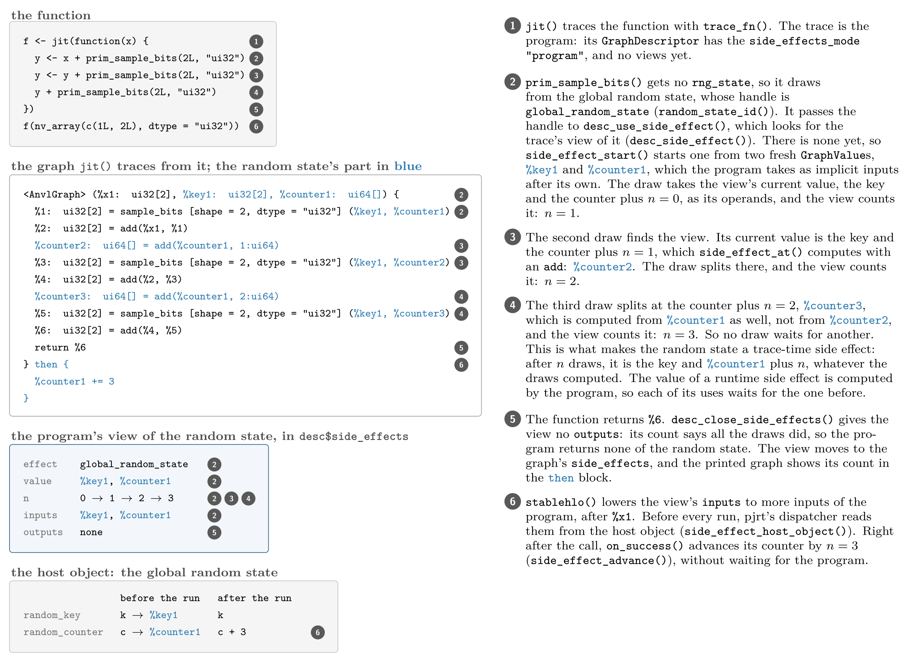
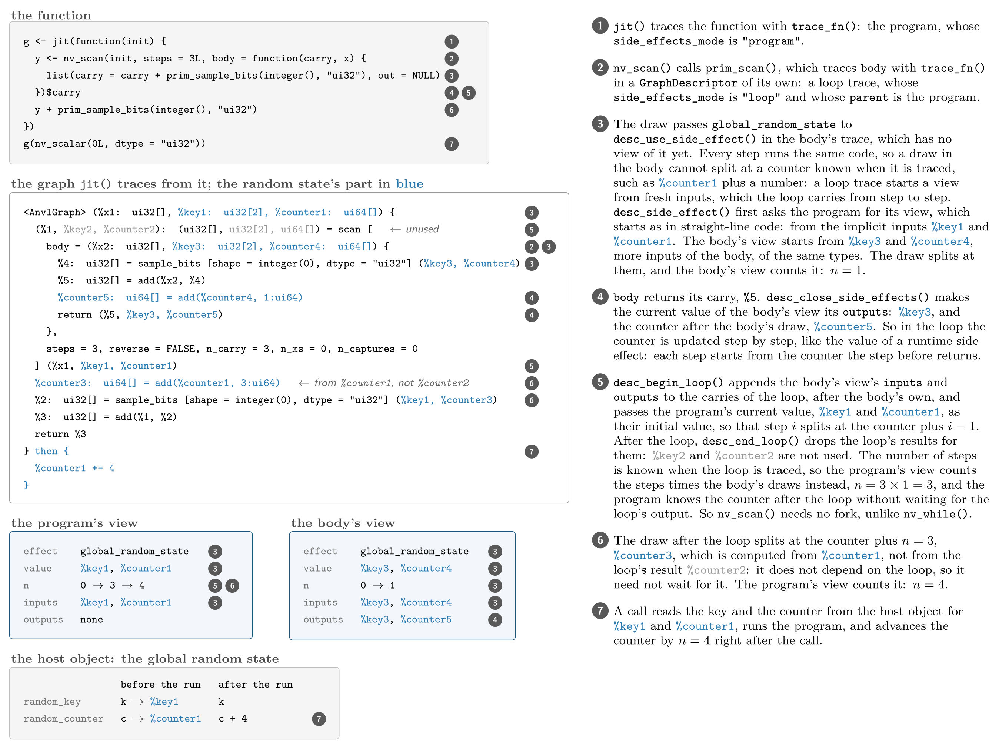
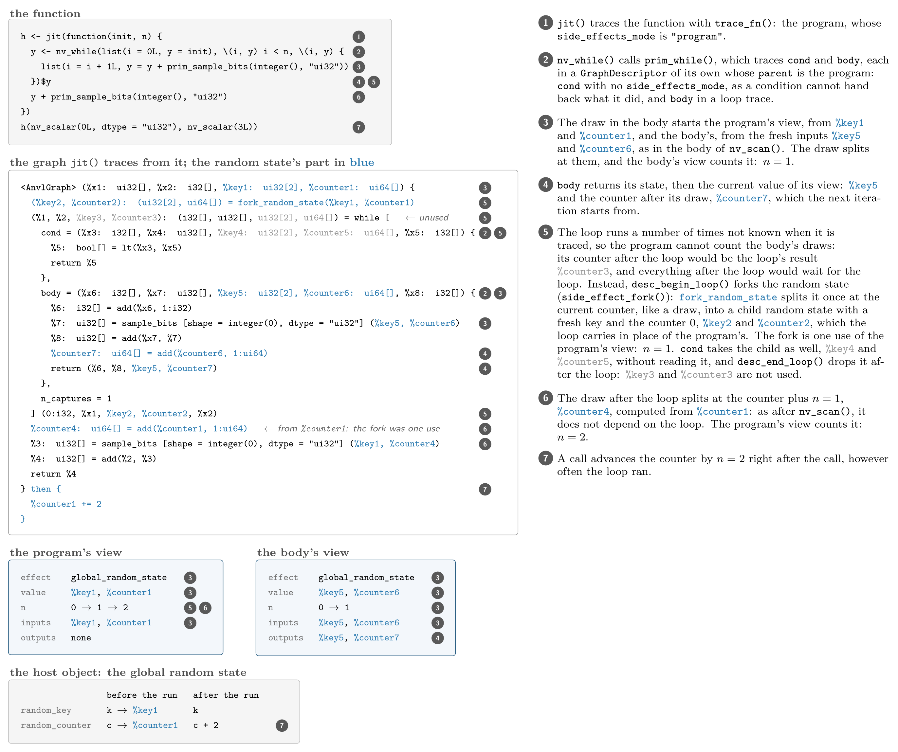
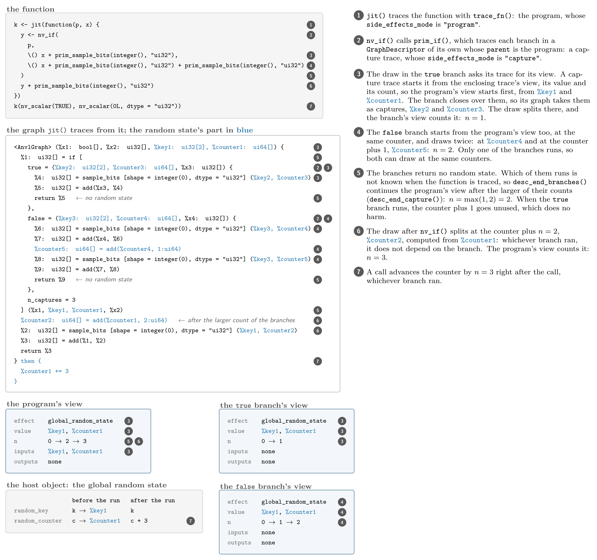
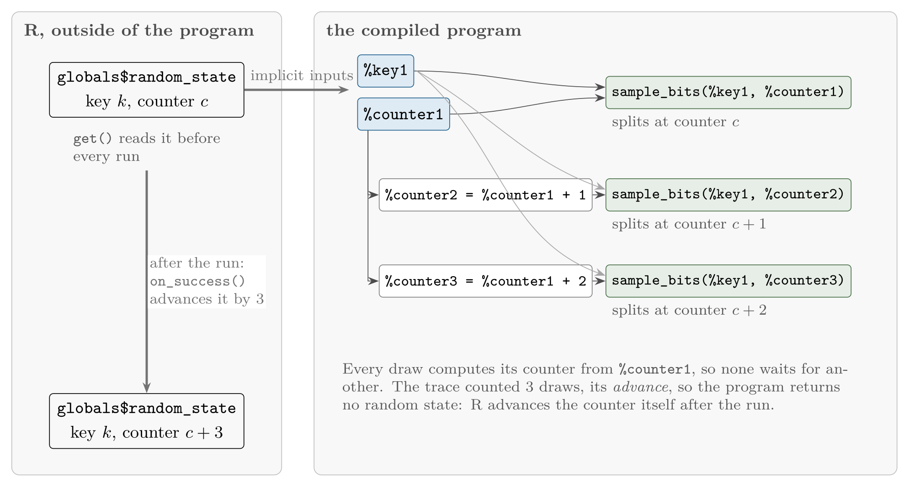
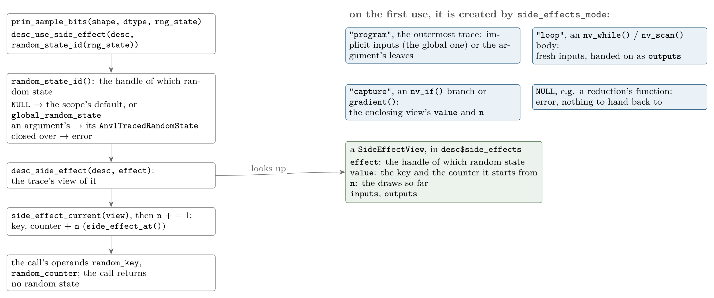
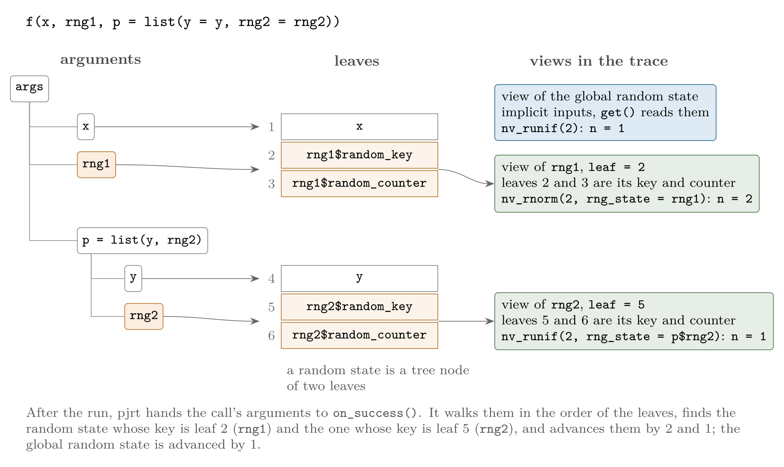
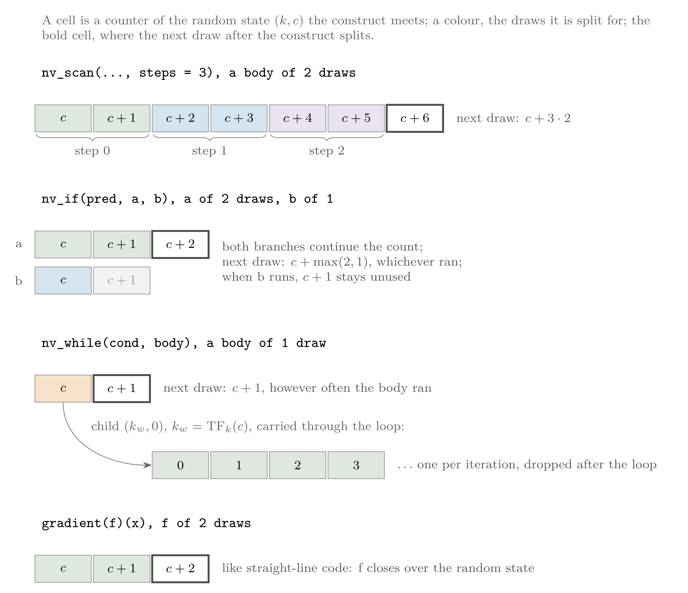

```{r, include = FALSE}
knitr::opts_chunk$set(
  collapse = TRUE,
  comment = "#>"
)
```

```{r, include = FALSE}
library(anvl)
```

A traced `AnvlGraph` describes a pure function: its outputs depend on its inputs alone, and running it changes nothing else.
Some primitives do not fit this picture: they read and update state that lives outside of the program.
Drawing random numbers is the example in {anvl} today: every draw reads the random state and advances it, and the random state lives in the global random state that `nv_set_seed()` seeds, or in a random state object that `nv_random_state()` creates.
{anvl} handles such state as a **side effect**: state that some primitives read and update, which the user never passes to them by hand, and which {anvl} takes through the trace instead.

This article describes the mechanism.
The [random numbers](random-numbers.html) article is the user-facing side of the random state.

## Two kinds of side effects

A side effect is one of two kinds, which share almost all of the mechanism and differ in what a trace hands back:

- A **trace-time** side effect is changed by its uses in a way the trace knows: the state after $n$ uses is a function of the state before and of $n$.
  A trace counts the uses, and hands back the count.
  The random state is one: a draw advances its counter by one, whatever it draws.
- A **runtime** side effect is changed by what the program computes: a use takes its current value and sets the next one.
  A trace hands back the value, which the program returns to the host.
  The error code of a check and the token that orders prints will be the first ones; the tests exercise the kind with a small side effect of their own (`tests/testthat/test-side-effects.R`).

The difference matters for the host.
A trace-time side effect lets the host advance the state by the count right after the call, without waiting for the program, so that a call never waits for the program of the call before it, also when CPU and GPU programs draw from the same random state.
A runtime side effect has to come back from the program.

## Three parts

A side effect has up to three parts, each of which lives somewhere else:

| part | what it is | where it lives | for how long |
|---|---|---|---|
| host object | the state between calls, e.g. the `AnvlRandomState` with its key and counter `AnvlArray`s; before every run the program's implicit inputs are read from it, and after the run it is updated. A side effect that starts afresh in every program has none. | on the host: `globals$random_state` for the global random state, the user's own object for a random state passed as an argument | from call to call |
| handle | the side effect's identity, with no value and nothing that changes; its class says which side effect it is, and inherits from `TraceTimeSideEffect` or `RuntimeSideEffect` | `global_random_state` in the package namespace; for a random state passed as an argument, the `AnvlTracedRandomState` the trace creates for it, which the traced function receives | for good, or one compilation |
| view | the side effect's value in one trace (`SideEffectView()`) | `desc$side_effects` of that trace, then the `side_effects` of its graph | one trace |

Every side effect has a handle, and a view in every trace that uses it.
Only one whose state lasts from call to call has a host object.

## One view per trace

A *trace* is one run of `trace_fn()` with a `GraphDescriptor` of its own, which becomes one `AnvlGraph`: the outermost trace of `jit()` or `trace_fn()` is the program, and every function a higher-order primitive traces is one more trace, such as each branch of `nv_if()` or the body of `nv_scan()`.

Every trace keeps one **view** of each side effect it uses, in `desc$side_effects`, in the order of first use: its value in that trace, a named list of `GraphBox`es, for a trace-time side effect the number of uses since that value (`n`), and the `GraphValue`s the trace takes and returns for it beyond its own inputs and outputs (`inputs`, `outputs`).
A use passes the side effect's handle, and `desc_side_effect(desc, effect)` finds the trace's view, or creates it on first use.
Where a view starts is decided by the trace's `side_effects_mode` (see `?GraphDescriptor`), which whoever opens the trace passes to `local_descriptor()`:

| mode | trace | the view starts from |
|---|---|---|
| `"program"` | the outermost trace of `jit()` or `trace_fn()` | wherever the side effect says (`side_effect_start()`): implicit inputs from the host, an argument, or a value the program creates |
| `"loop"` | the body of `nv_while()` or `nv_scan()` | fresh inputs, which the loop carries |
| `"capture"` | a branch of `nv_if()`, the function `gradient()` differentiates | the enclosing trace's view: its value, and its count |
| `NULL` | the condition of `nv_while()`, the function of a reduction, a scatter or a sort | nowhere: using a side effect is an error, as such a function cannot hand back what it did |

A graph keeps the views of its trace in its `side_effects` field, apart from its `inputs` and `outputs`, so that `in_tree` and `out_tree` keep describing what the user passes and gets back:

```{r}
graph <- trace_fn(function(x) x + prim_sample_bits(2L, "ui32"), list(x = nv_aval("ui32", 2L)))
view <- graph$side_effects[[1L]]
view$effect
view$n
names(view$inputs)
```

The figure follows a function that draws three times from the global random state, from its trace to a call: the numbers in the function, the graph and the view mark what each note describes, and the part of the graph that implements the random state is blue.

```{r, echo = FALSE, out.width = "100%"}

```

A sub-graph's views are folded into its inputs and outputs by the construct that traced it.

## What comes back out

Inside a loop, both kinds carry their value from one iteration to the next.
Out of a loop, a branch, a differentiated function or the program, a runtime side effect hands back its value, and a trace-time side effect its count:

| construct | runtime side effect | trace-time side effect |
|---|---|---|
| straight-line uses | each use sets the next value | each use adds one to the count |
| `nv_scan(steps = k)` | continues from the loop's result | adds $k$ times the body's count |
| `nv_while()` | continues from the loop's result | the body starts from a fork (`side_effect_fork()`), one use of the enclosing trace; the loop adds nothing else |
| `nv_if()` | continues from the result of the branch that ran | continues after the larger of the branches' counts |
| `gradient()` | continues from the differentiated function's last value | continues after its count |
| the program | its last value is an implicit output, handed to `side_effect_receive()` | no output; `side_effect_advance()` adds the count on the host |

The figure follows a draw in the body of an `nv_scan()` of three steps, and one after the loop.
Every step runs the same code, so the body's view starts from fresh inputs, which the loop carries from step to step.
The program's view counts three times the body's draw instead of taking the loop's result, so that the draw after the loop does not depend on the loop.

```{r, echo = FALSE, out.width = "100%"}

```

The number of iterations of `nv_while()` is not known when it is traced, so a trace-time side effect cannot count them: the loop forks it instead, and the enclosing trace counts the fork as one use.
The figure follows a draw in the body of an `nv_while()`, and one after the loop.

```{r, echo = FALSE, out.width = "100%"}

```

Only one branch of `nv_if()` runs, and which one is not known when it is traced: both branches start from the enclosing trace's view, and the enclosing trace continues after the larger of their counts.
The figure follows an `nv_if()` whose branches draw once and twice, and a draw after it.

```{r, echo = FALSE, out.width = "100%"}

```

A side effect cannot also be passed through the state of a loop by hand, as the loop carries it itself; `nv_while()` and `nv_scan()` refuse one there.

## What a side effect provides

All of this is generic code in `R/side-effects.R`.
A side effect only provides a few S3 methods on its handle:

| generic | kind | the random state |
|---|---|---|
| `side_effect_start(effect, desc)` | both | the global random state's key and counter as implicit inputs, a random state argument's from among the inputs |
| `side_effect_host_object(effect, args)` | both | the global random state, or the random state among the call's arguments |
| `side_effect_at(effect, value, n)` | trace-time | the key and the counter plus `n` |
| `side_effect_fork(effect, value)` | trace-time | a call of `prim_fork_random_state()` |
| `side_effect_advance(effect, object, n)` | trace-time | advances the object's counter by `n` |
| `side_effect_receive(effect, object, value)` | runtime | -- |
| `side_effect_format(effect, ids, n)` | trace-time | the `then` line of a printed graph, `%counter1 += n`; the default says `n` uses |

## The random state

A random state is a ThreeFry key $k$ and a counter $c$.
A draw *splits* it at its counter, deriving a fresh key from $k$ and $c$ to draw from, and advances the counter by one, however many values it drew.
Because a draw's values depend on nothing but the key and the counter it splits at, the random state is a trace-time side effect: the state after $n$ draws is the key $k$ and the counter $c + n$, whatever the draws computed.
So a compiled function does not have to hand the random state from one draw to the next, nor return it:

- the program takes the key and the counter as inputs, and the $j$-th draw splits at the counter $c + j$, computed from the one the program took, so that no draw waits for another;
- the program returns no random state: after the run, {anvl} advances the counter by the number of draws the trace counted.

```{r, echo = FALSE, out.width = "100%"}

```

The printed graph shows the same: the key and the counter are inputs, labelled `%key1` and `%counter1`, the second and third draw take counters computed from `%counter1`, and the `then` block after the graph says what happens after the run: the counter advances by the number of draws, here `%counter1 += 3`.

```{r}
trace_fn(
  function() list(prim_sample_bits(2L, "ui32"), prim_sample_bits(2L, "ui32"), prim_sample_bits(2L, "ui32")),
  list()
)
```

Fixing every advance when the function is traced, rather than when it runs, is what lets every draw compute its counter from the counter the program starts from, and the host advance the random state after a call by a number known in advance.
The same property will let a future `vmap()` or `parallel_map()` of a function give each element the counter a hand-written loop over the elements would give it.

So a compiled function draws exactly what the same calls made one after the other without `jit()` would draw, and leaves the global random state where they would leave it:

```{r}
f <- function() list(nv_runif(2L), nv_rnorm(2L))
nv_set_seed(1L)
eager <- f()
nv_get_random_state()
nv_set_seed(1L)
compiled <- jit(f)()
nv_get_random_state()
identical(lapply(eager, as_array), lapply(compiled, as_array))
```

A draw is one call of `desc_use_side_effect()`: it finds the trace's view of the random state that `random_state_id()` names (the one `local_nv_rng_state()` made the default, or else the global one), passes the view's key and its counter plus `n` (`side_effect_current()`) to the call as ordinary operands, and counts the draw.
The call returns no random state: the next draw computes its own counter from the view again.

```r
prim_sample_bits <- new_primitive(
  "sample_bits",
  function(shape, dtype) {
    graph_desc_add(
      self,
      desc_use_side_effect(current_descriptor(), random_state_id()),
      params = list(shape = shape, dtype = dtype),
      infer_fn = infer_sample_bits
    )[[1L]]
  },
  static = c("shape", "dtype")
)
```

```{r, echo = FALSE, out.width = "100%"}

```

### Random states of their own

A function can draw from the global random state and from random states of its own, and the trace keeps them apart: each has its own handle, and so its own view.

- `global_random_state` stands for the global random state. R holds it outside of any program; the program takes its key and counter as **implicit inputs**, which pjrt's dispatcher reads from it before every run, and does not count them among the call's arguments.
- A random state passed to the jitted function as an argument becomes an `AnvlTracedRandomState` of its own when the trace rebuilds the arguments from their leaves, and that is what the function receives, and what `local_nv_rng_state()` makes the default of the draws in its scope (`globals$default_traced_random_state`). It holds the `GraphValue`s of the key and the counter the trace was given.

An `AnvlTracedRandomState` reads like the random state it stands for: its `random_key` and `random_counter` are active bindings that return the key and the counter where the reading trace is, the counter after the draws so far.
So a jitted function reads what the same code reads eagerly, where every draw advances the random state in place:

```{r}
f <- function(s) {
  local_nv_rng_state(s)
  nv_runif(2L)
  list(s$random_counter, nv_runif(2L), s$random_counter)
}
jit(f)(nv_random_state(1L))[c(1L, 3L)]
f(nv_random_state(1L))[c(1L, 3L)]
```

It is a handle, not a value: it cannot be returned, carried through a loop, or passed to an operation as an array.

A random state among the arguments is not special to the dispatcher: `AnvlRandomState` is registered as a node of pjrt's argument tree (`pjrt::register_tree_node()`), whose two children are its key and its counter.
So the arguments are flattened into leaves, a random state contributing two of them, and the program takes those as ordinary inputs.
Every random state gives two leaves of the same types, so one compiled program serves every random state passed there.
After the run, pjrt hands the call's arguments to the entry's `on_success()`, which finds the random state at the position of its key and advances it.

```{r, echo = FALSE, out.width = "100%"}

```

So one side effect can appear several times in a graph, once per random state:

```{r}
graph <- trace_fn(
  \(rng1, rng2) list(with_nv_rng_state(rng1, prim_sample_bits(2L, "ui32")), with_nv_rng_state(rng2, prim_sample_bits(2L, "ui32"))),
  list(nv_random_state(1L), nv_random_state(2L))
)
graph
vapply(graph$side_effects, `[[`, numeric(1L), "n")
```

and a compiled function advances each random state it is passed by its own draws, and the global random state by the rest:

```{r}
f <- jit(function(rng1, p) {
  list(with_nv_rng_state(rng1, nv_rnorm(2L)), with_nv_rng_state(p$rng2, nv_runif(2L)), nv_runif(2L))
})
rng1 <- nv_random_state(1L)
rng2 <- nv_random_state(2L)
nv_set_seed(3L)
invisible(f(rng1, list(rng2 = rng2)))
rng1
rng2
nv_get_random_state()
```

Two things cannot work this way, and are errors:

- A random state the function closes over is not among its leaves, so the program could neither take its current key and counter nor advance it.
- The same random state passed twice would have two views that start from the same key and counter and so draw the same numbers; `on_success()` finds every view's host object before it advances any, and refuses an object found twice.

### Loops and branches

A loop body or a branch is traced once but runs any number of times, or not at all.
For the draws to stay known when the function is traced, the generic code hands what a sub-trace's view did to the enclosing trace's view, which for the random state means:

```{r, echo = FALSE, out.width = "100%"}

```

- `nv_scan()` runs its body a known number of times. The body takes the random state as one more member of the carry: it starts at the enclosing trace's next count, and returns it after its own draws, so that step $i$ splits at the counters after $i$ bodies. The enclosing trace continues after the number of steps times the body's draws (`desc_begin_loop()`, `desc_end_loop()`).
- `nv_if()` lets both branches start from the enclosing trace's view and continue its count; the enclosing trace then continues after the larger of the two branches' draws, whichever branch ran (`desc_begin_branches()`, `desc_end_capture()`).
- `nv_while()` runs its body a number of times not known when it is traced, so the body cannot continue the enclosing count. Instead the loop *forks* the random state: it splits it once, like a draw, but makes the fresh key a child random state with the counter 0, which the body carries through the loop and advances as often as it runs. The enclosing trace advances by one, the fork, however often the body ran, and drops the child after the loop (`side_effect_fork()`).
- The function `gradient()` differentiates runs once, so its draws continue the enclosing count like straight-line code; its graph starts from the enclosing trace's view, and hands its draws to the enclosing trace like a branch does (`desc_end_capture()`).

```{r}
trace_fn(
  function(n) {
    nv_while(list(i = 0L), \(i) i < n, \(i) {
      prim_sample_bits(1L, "ui32")
      list(i = i + 1L)
    })
  },
  list(n = nv_aval("i32", integer()))
)
```

The loop body takes the child random state as `%key5` and `%counter5`, and hands the advanced counter to the next iteration; the enclosing graph forks once and uses the random state once.

The fork splits the random state $(k, c)$ like a draw, but instead of drawing from the fresh key $k_w = \mathrm{TF}_k(c)$, it returns the child random state $(k_w, 0)$, and advances the random state to $(k, c + 1)$.
It is available as `prim_fork_random_state()`:

```{r}
nv_set_seed(1L)
prim_fork_random_state()
nv_get_random_state()
```

The fork is the price of fixing every advance when the function is traced: `nv_while()` is the one construct whose eager counterpart, an R `while` loop, draws differently.

## Lowering and running

`stablehlo()` lowers the views' `inputs` to more inputs of the program, after the graph's own inputs, and the views' `outputs` to more outputs, after the graph's own outputs; a random state passed as an argument is among the graph's inputs already.
The pjrt backend (`compile_graph_pjrt()`) then hands pjrt's dispatcher:

- `implicit_inputs` (`side_effects_implicit_inputs()`): one `list(get, dtype, shape)` per view input, whose `get()` reads the buffer of the field of that name of the side effect's host object (`side_effect_host_object()`), e.g. the global random state's `random_key`. The buffer may live on any device; pjrt copies it to the program's device if it is on another.
- `implicit_outputs` (`side_effects_implicit_outputs()`): one `list(dtype, shape)` per view output, the values of the runtime side effects the program returns.
- `on_success(outputs, args)` (`side_effects_on_success()`): called after every successful run with the implicit outputs and the call's arguments. It finds every view's host object, refuses one found twice, advances each trace-time side effect by its count (`side_effect_advance()`) and hands each runtime side effect its values (`side_effect_receive()`). It keeps only plain data, the handles and the counts, so a cached program keeps no trace alive.

None of this is part of the cache key: whether a program uses a side effect is decided by the program, and which random state is passed by the arguments' leaves, whose types are always the same.
The quickr backend runs no side effects, so it refuses a function that uses one.

## Where it lives

| part | where |
|---|---|
| the mechanism: views, where they start, loops, branches, the host | `R/side-effects.R`: `SideEffectView()`, `desc_side_effect()`, `desc_use_side_effect()`, `desc_close_side_effects()`, `desc_begin_loop()`, `desc_end_loop()`, `desc_begin_branches()`, `desc_end_capture()`, `side_effects_on_success()`, ... |
| the random state's handle and methods, and the tree node | `R/rng.R`: `traced_random_state()`, `random_state_id()`, the `side_effect_*()` methods for `AnvlTracedRandomState`, `random_state_argument()` |
| recording a call, closing a trace | `R/graph.R`: `graph_desc_add()`, `trace_fn()` |
| the draws and the fork | `R/primitives.R`: `prim_sample_bits()`, `prim_fork_random_state()`; their lowering in `R/rules-stablehlo.R` |
| loops and branches | `R/primitives.R`: `prim_while()`, `prim_scan()`, `prim_if()` |
| gradients | `R/reverse.R`: `graph_gradient()`, `graph_value_and_grad()`, `trace_value_and_grad()` |
| lowering and running | `R/stablehlo.R`: `stablehlo()`; `R/backend-pjrt.R`: `compile_graph_pjrt()` |
| printing | `R/graph-print.R` |
